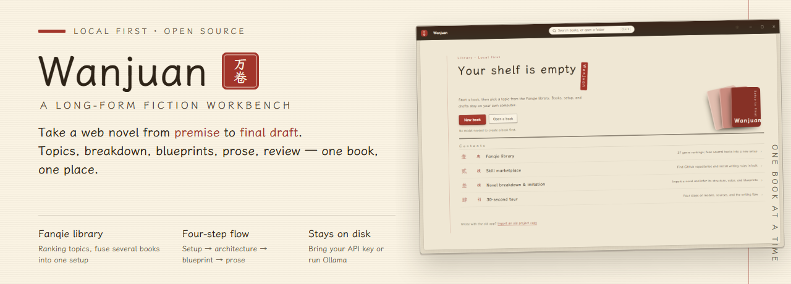
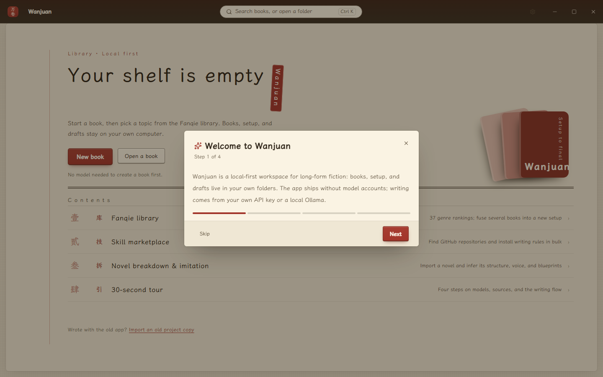
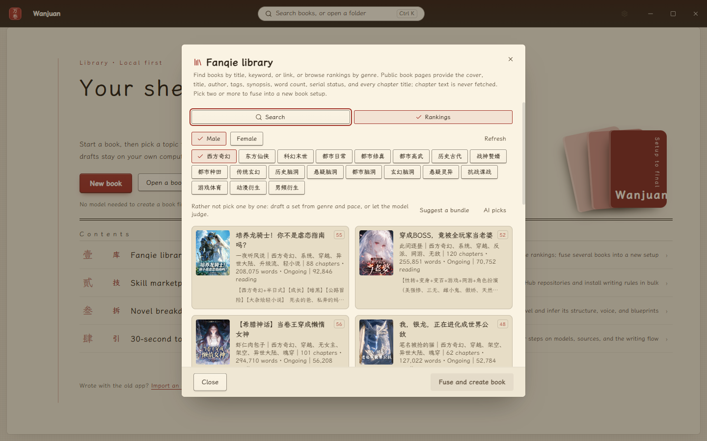
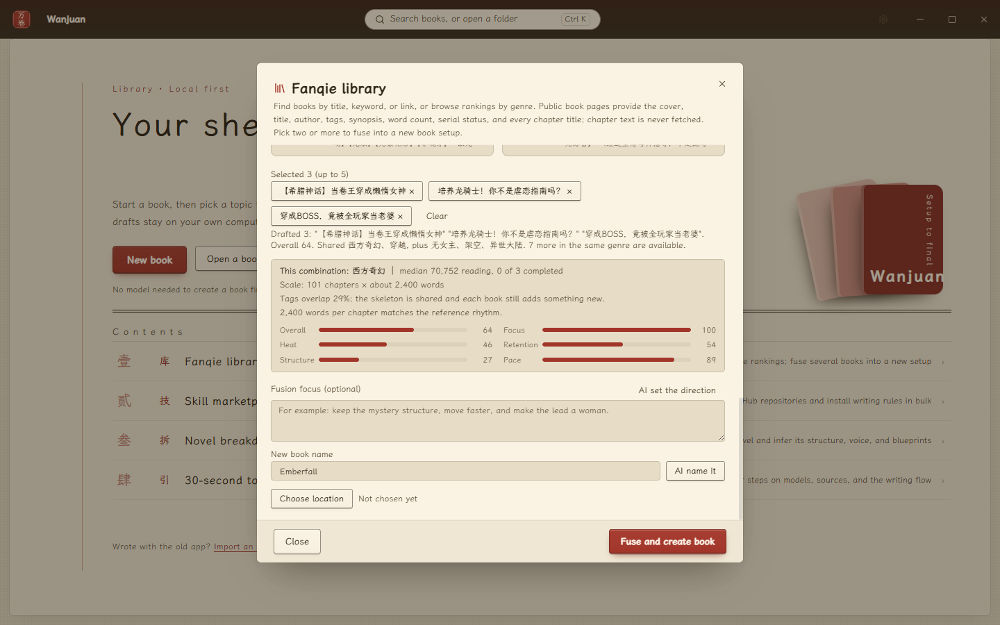
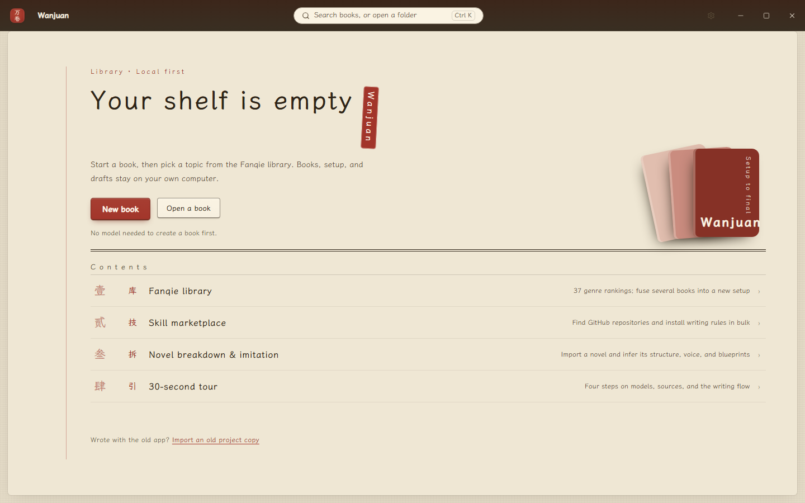
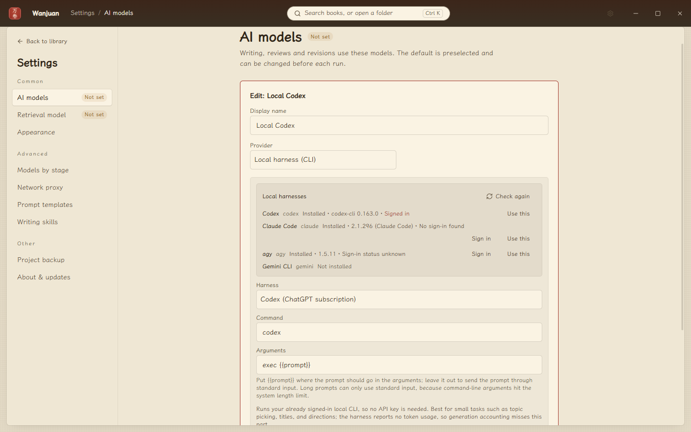

<div align="center">

**English** | [中文](README.md) | [日本語](README_ja.md)

</div>

<p align="center">
  
</p>

<h1 align="center">Wanjuan</h1>

<p align="center"><sub>A local-first workbench for long-form fiction, from topic to final draft</sub></p>

<p align="center">
  <a href="https://github.com/1210350468/wanjuan/releases/latest"></a>
  <a href="LICENSE"></a>
  
  
</p>

<p align="center">
  <strong>Free and open-source AI novel writing software. Topic, setup, architecture, chapter blueprints, prose, review, revision, and final draft, all inside one book.</strong><br />
  Your books stay on your own computer. No model is bundled: bring your own API key, or run a local model with Ollama.
</p>

Wanjuan is derived from Pagekin (formerly 书童). The original writing flow is kept intact, with a Fanqie book library, multi-book fusion, a Skill marketplace, and first-run onboarding on top. Upstream project: [EthanYoQ/Pagekin](https://github.com/EthanYoQ/Pagekin). Attribution and licensing are in [NOTICE.md](NOTICE.md).

## Three-minute start

| Step | What to do |
|---|---|
| 1. Install | Download `wanjuan-setup-<version>.exe` (Windows) or the `.dmg` for your architecture (macOS) from [Releases](https://github.com/1210350468/wanjuan/releases/latest). The installers are not code-signed, so allow the unknown-publisher prompt as described under [Download and install](#download-and-install). |
| 2. Configure a model | Open "Settings → AI model", pick a provider preset (DeepSeek, Zhipu, SiliconFlow, and others), fill in the API key and model name, and choose "Test connection". For zero cost, start with [Ollama](#run-a-local-model-with-ollama). |
| 3. Create a book | Back in the library, choose "New book", give it a name, and pick a folder. Genre, total chapters, and words per chapter are set on the setup page. |
| 4. Write to final | Follow setup → architecture → blueprint → prose. Every step can be drafted by AI and confirmed by you. Once the prose is done, review it, revise it, and finalize the chapter. |

The first launch shows a four-step tour covering the model, reference sources, and the writing order. Reopen it any time from the empty library via "30-second tour".

<p align="center">
  
</p>

## How writers make money with Wanjuan

There are only so many ways to earn from web fiction; what separates authors is output and topic choice. Wanjuan saves concrete time at every stage.

| Route | Where the money comes from | Where Wanjuan helps |
|---|---|---|
| **Revenue share on free-reading platforms** | Fanqie, Qimao, and similar platforms pay from reading time and ads; signed authors receive a manuscript fee | The Fanqie library shows what is actually charting, by male-lead and female-lead genre, so topic choice is not guesswork; batch blueprints keep a daily release schedule unbroken |
| **Revenue share on paid subscriptions** | Qidian, Jinjiang, and similar platforms pay from subscriptions, monthly votes, and tips | Chapter blueprints pin down each chapter's conflict and hook first, and the review report gives note-by-note feedback, so quality stays steady enough to list |
| **Attendance bonuses and minimum guarantees** | Platforms pay an attendance bonus for daily word count, and signed authors get a floor | "Batch write" drafts up to 10 chapters in one run, so a daily quota no longer means staying up all night |
| **Short drama and audiobook adaptation** | Rights buyers pay a flat fee or a share | The hooks in a blueprint are exactly what adapters look for, and the plot & threads page shows at a glance which chapter plants which thread |
| **Ghostwriting and studio work** | Clients pay per thousand characters; studios ship in volume | Import a client's manuscript and continue it, break down and imitate their voice, and run several books at once |
| **Newsletters and subscription columns** | WeChat accounts and Zhihu columns pay per piece or per subscriber | Break down a hit's structure to reverse-engineer blueprints, and learn a genre's craft quickly |

A route you can actually start on:

1. Open "Fanqie library → Genre rankings", look at two or three genres, and pick one with plenty of charting books that you can also write.
2. Choose "Suggest a bundle" to let the app draft three books of one genre, read the diagnosis (genre, scale, pace), then choose "AI set the direction" and generate the new book setup. References supply genre and structure only; characters, place names, and plot are all new.
3. Write the first ten chapters as a test: generate blueprints ten chapters at a time, draft with batch write, then review and revise chapter by chapter.
4. Submit those ten chapters to a platform, or start serializing directly, and let the retention numbers decide whether to speed up. If the numbers are bad, change genre and start over; the sunk cost is ten days.

Whether you make money depends on the work itself and on platform rules. Wanjuan raises output and the odds of picking a topic that lands; it promises no income. Policies on AI-generated content differ by platform, so check the author agreement of your target platform before publishing.

<p align="center">
  
</p>

<p align="center">
  
</p>

## The library: every book in one place

The library lists every book you have written. Select a cover to preview it: the current step, word count, final chapters, and characters. You can start a new book, or import a project from an older version as a copy.

The first launch is an empty library: "New book" and "Open a book" on the left, and a four-row contents list below that takes you to the Fanqie library, the Skill marketplace, novel breakdown & imitation, or the 30-second tour. If you wrote with an older version, the footnote at the bottom imports a copy of that project.

<p align="center">
  
</p>

## Where first runs get stuck

| Symptom | What to do |
|---|---|
| The installer says "unknown publisher" | The installers are not code-signed. Confirm it came from this repository's Release, then choose "More info → Run anyway"; on macOS, Control-click the app and choose "Open". |
| "Test connection" fails | Check the Base URL first. Services such as DeepSeek and OpenAI need the exact path from their docs, usually ending in `/v1`. Keep the API key free of spaces and quotes. |
| Ollama on 11434 is unreachable | Make sure Ollama is running (`ollama list` returns a model), then set the Base URL to `http://127.0.0.1:11434/v1`, not `/api`. |
| Nothing appears while writing a chapter | Open the run sheet and look at that run: it may still be waiting on the model, or the request may have been rejected for quota or context length. Text already written is kept as a recovery candidate. |
| The prose does not sound like what you wanted | Fix the blueprint's conflict and hook first; changing the model is a second step. A vague blueprint gets vague chapters from any model. |

## What it does

Wanjuan works in the order a novel gets written: you are the author, it is your desk. Each step is saved in the book and feeds the next one. AI drafts, and you confirm every step.

### Fanqie library: find topics, fuse several books

Find books on Fanqie by title, keyword, or book link, or browse rankings by genre: 19 male-lead and 18 female-lead categories, each listing that category's ranked books with covers, synopses, word counts, and serial status. It reads public book pages only: cover, title, author, tags, synopsis, word count, serial status, and every chapter title. Chapter text is never fetched.

Rather not pick one by one? Choose "Suggest a bundle": the app drafts three books from the current results by genre skeleton, chapter pace, and readership, and explains the shared genre plus what each book adds. Once you tick two to five books, a diagnosis panel shows the genre, the scale to plan for (chapters x words per chapter), how much the tags overlap, and whether the pace runs faster or slower than the platform norm. It also scores the set from 0 to 100: an overall figure plus genre focus, heat, retention, structure, and pace. Every candidate card carries its own overall score in the corner, so you can compare before ticking. You can also choose "AI picks": the candidate tags, readership, scale, status, and scores go to the model, which decides which two or three books to fuse, why, and in what direction. When it cannot pick, you get an explicit error instead of a made-up set. Write the direction yourself, or choose "AI set the direction" to get two directions from the model and click one to fill it in; titles work the same way through "AI title". Pick a folder, confirm the name, then choose "Fuse and create book": the app creates the book, writes the total chapter count and words per chapter from the median of the references, and asks AI to generate the setup, architecture, and core outline. References supply genre and structure only; the fused result never reuses their characters, place names, or specific plot.

The scores are not ad-hoc weights; each one has a reason:

| Score | Book weight | Set weight | How it is computed | Why |
| --- | --- | --- | --- | --- |
| Heat | 30% | 22% | `log10(readers)` mapped from 10³ to 10⁷ onto 0–100 | Readership is long-tailed, so only a log scale matches how it feels |
| Retention | 20% | 16% | Per-chapter readers shrunk with `(v·R + m·C)/(v+m)`, then log-mapped to 0–100 | IMDb weighted rating: 1M readers over 10 chapters should not beat 1M over 1000 |
| Structure | 25% | 20% | Completed 100; serial by chapter count 20–90; unknown 40 | Length and completion decide how much a book can actually lend |
| Pace | 25% | 20% | `exp(−δ²/2σ²)`, δ the log distance of words-per-chapter from 3000, σ=0.5 | Gaussian kernel: deviating from the norm decays smoothly, not as a cliff |
| Genre focus | — | 22% | Mean pairwise Jaccard of tags; below 0.15 drops to 45, above 0.6 drops to 55 | Set coherence: too scattered reads as no theme, too identical adds nothing |

Heat, retention, structure, and pace for a set are the **median** of its books, so one weak pick does not sink the set. The shrinkage prior is 300 chapters at 300 readers each: the usual "pull small samples toward the platform mean" move, not a fitted optimum, but every number can be explained to you.

Keyword search locates book IDs through Bing site search. When that service is unavailable, the app falls back to ranking entries whose titles match, and you can always paste a book link.

### Breakdown, imitation, continuation, rewriting

"Novel breakdown & imitation" in the library imports a novel as a .txt, .md, or .epub file, splits it into chapters, and asks what the text is for.

- **Breakdown and imitation**: choose "Reference novel". AI breaks down its structure, extracts its style, infers chapter blueprints, and produces imitation constraints for your later writing. A reference novel goes only into the knowledge base and the breakdown; it never mixes into your prose.
- **Continue your manuscript**: choose "My manuscript". The chapters you already wrote are imported by chapter number as finalized text, and AI continues the following chapters from those characters and events.
- **Continue a passage**: select text in the prose editor and choose Continue on the toolbar; AI writes on from that passage.
- **Rewrite**: to rewrite a whole chapter, use Revise. Write the direction you want, optionally check review notes, and compare the result with the original paragraph by paragraph to choose which version to keep. For a short passage, select it and use Refine, Expand, or To dialogue on the toolbar.

### Setup and architecture: build the story first

The setup page records the genre, audience, writing language, total chapters, and words per chapter. The architecture page has four sections: premise, cast, worldbuilding, and plot outline. AI can generate each section, or you can write it yourself. When all four are confirmed, move on to chapter blueprints.

The cast is edited alongside the architecture. Each character has a profile, a current state, and a relationship graph. You can paste character cards or import them from a file.

### Chapter blueprints: plan each chapter before writing

The blueprint page plans the book chapter by chapter. Each chapter states the protagonist's goal, the conflict and turn, the suspense hook, and the characters who appear. AI can generate blueprints in chapter ranges, and an interrupted run can continue.

The main button is "Write chapter N". The small popover next to it holds only the options for this run: which model to use and an optional line of author guidance. To write several chapters in a row, use "Batch write", up to 10 chapters at a time.

### Manuscript: draft, review, revise, finalize

The single-chapter view takes a chapter from unwritten to final. After AI writes a draft, you can edit it yourself or ask AI to review it. The review report lists each note. You check or ignore each one, and you can add your own. The revision comes back as a diff that you confirm paragraph by paragraph, so nothing is overwritten. When it reads right, finalize the chapter.

While writing, AI receives this chapter's blueprint, the related characters, the worldbuilding, summaries of earlier chapters, and the full previous chapter, not a chat transcript of the whole book.

In the prose editor, Tab inserts two full-width spaces as a paragraph indent. A whole chapter can be written with the keyboard alone.

### Run sheet: see what AI is doing

Every generation run appears in the run sheet, with In progress, History, and Diagnostics tabs. You can watch the output as it is written and cancel at any time. A batch can be paused. If a run fails, the text written so far is kept as a recovery candidate that you can copy or discard.

### References and versions: keep track of a long book

- **Plot & threads**: follow the main plot, subplots, and foreshadowing chapter by chapter, and record where each thread is planted, advanced, or resolved.
- **Knowledge base**: import reference material (.txt, .md). Local full-text search works even without a retrieval model.
- **Version history**: every past version of a chapter is kept. Compare it with the current draft, or restore it as a new draft.
- **Export and backup**: export as merged Markdown, one Markdown file per chapter, or plain text. Archive a book on your computer or back it up to a WebDAV cloud you connect. Restoring always creates a new copy.

### Writing skills: bring your own writing rules

On the "Writing skills" settings page, choose a local skill folder or a single SKILL.md, or enter the address of a skill on GitHub, to import a prompt-only writing skill, such as one that removes the typical AI tone, or one for a particular style or genre. Reference text files that SKILL.md cites are included. The app reads the skill and shows you its content before you install it. Bind it to the planning, drafting, review, or revision stage, and every generation in that stage includes it.

Choose "Skill marketplace" and the app automatically scans the built-in sources, lists installable skills, and offers an install-all action. You can also paste a GitHub repository to scan it alone, or search repositories by keyword. Repository results carry the description, stars, and last update, read live from GitHub. Each row shows the stage, language, number of bundled reference files, and the reason a skill cannot be installed (scripts, hooks, subagents, or more than 64 KiB after merging). Skills already installed from the same repository are marked as installed.

Only self-contained SKILL.md prompts are supported. Scripts, hooks, subagents, and tool requirements are not installed, so a skill cannot run code on your computer.

### Dark theme and two interface languages

Appearance offers a light "aged paper" theme and a dark "reading at night" theme. The interface is available in Chinese and English. A book's writing language can be Chinese or English.

## Supported models and services

Wanjuan does not provide models or host quotas. In settings, enter your own service address, model name, and API key. Three request paths are supported:

- **OpenAI-compatible**: any service compatible with the Chat Completions API.
- **Native Gemini**: Google Gemini.
- **Local harness (CLI)**: calls a command-line agent you already signed in to, such as `codex`, `gemini`, or `claude`.

Settings include presets for these providers:

| Provider | Protocol | Notes |
| --- | --- | --- |
| DeepSeek | OpenAI-compatible | Preset address `https://api.deepseek.com` |
| SiliconFlow | OpenAI-compatible | Preset address `https://api.siliconflow.cn/v1` |
| BigModel (Zhipu) | OpenAI-compatible | Preset address `https://open.bigmodel.cn/api/paas/v4` |
| OpenAI | OpenAI-compatible | Preset address `https://api.openai.com` |
| xAI (Grok) | OpenAI-compatible | Preset address `https://api.x.ai/v1` |
| Google Gemini | Native Gemini | Preset address `https://generativelanguage.googleapis.com` |
| Ollama (local) | OpenAI-compatible | The model runs on your own computer |
| NovelAI | OpenAI-compatible | Minimal compatibility, not fully verified with a real account |
| Local harness (CLI) | CLI | Calls the `codex`, `gemini`, or `claude` you already signed in to, with no API key |
| Custom | OpenAI-compatible | Any compatible service address |

"Custom" only changes the address, model name, and credentials within the OpenAI-compatible or native Gemini protocols. It is not an arbitrary HTTP interface. Anthropic, Azure, native KoboldAI, and similar interfaces need dedicated adapters, and a URL swap does not make them work.

Semantic search in the knowledge base needs a separate embedding model, configured under "Retrieval model" in settings.

### Use the CLI that comes with your subscription

Besides an API key, Wanjuan can call an agent CLI you are already signed in to: with a ChatGPT subscription use `codex`, with a Google account use `gemini`, with Claude use `claude`. Those tools spend your own subscription quota, so no separate key is needed.

You do not have to work out the command yourself. The page scans PATH (including `~/.local/bin`, Homebrew, and the npm global directory, which a GUI launch does not inherit), runs `--version` once, and checks whether credential files exist, then lists `codex`, `gemini`, `claude`, and `agy` with their version and sign-in state. Choose "Use this" on a signed-in one and the command and arguments are filled in; choose "Sign in" on the others and the system terminal opens `codex login` or `claude` (type `/login` inside Claude Code). Come back to the app and it checks again by itself.

```text
Settings -> AI models -> New -> Provider: Local harness (CLI)
Harness:  Codex / Gemini CLI / Claude Code / agy / Custom
Command:  codex
Arguments: exec {{prompt}}
```

Put `{{prompt}}` where the prompt should go in the arguments; leave it out and the prompt is written to standard input. A harness has no system role, so messages are joined in order. It reports no token usage, so generation accounting misses that part; it suits small tasks such as topic picking, titles, and directions.

<p align="center">
  
</p>

Detection is read-only: credential files are checked for existence and size, never read, and nothing is uploaded. Sign-in happens in the system terminal, so the app itself never touches a token.

### Run a local model with Ollama

```text
Provider:  Ollama (local) or Custom
Protocol:  OpenAI-compatible
Base URL:  http://127.0.0.1:11434/v1
API key:   may be left blank; if the UI requires one, use any placeholder
Model:     your Ollama model name, for example qwen3:14b
```

Embedding models also use the `/v1` address. Do not use `http://127.0.0.1:11434/api`, which is Ollama's native interface.

## Download and install

Installers are published in this repository's [Releases](https://github.com/1210350468/wanjuan/releases/latest).

### Windows x64

```text
wanjuan-setup-<version>.exe
```

1. Run the installer. An upgrade updates only the application and does not delete books, character cards, or settings. Back up important work first anyway.
2. After installation, check for updates under "Settings → About & updates". A new version is announced first. It downloads only after you choose "Download update", and when it finishes you choose to restart now or later.
3. Older portable ZIP builds cannot get the updater automatically. Install an official installer manually once.

The installer is not code-signed at present. Windows may show an unknown-publisher warning. Continue only after confirming that the download page is this repository's official GitHub Release.

### macOS (Apple Silicon and Intel)

```text
wanjuan-mac-arm64-<version>-installer.dmg
wanjuan-mac-x64-<version>-installer.dmg
```

1. `arm64` is for Apple Silicon Macs (M1, M2, M3, M4, and later). `x64` is for Intel Macs.
2. Drag the app from the DMG to Applications and launch it. The app announces new versions but does not download or replace itself on macOS. Updating opens the official Release page so you can download the installer for your architecture.
3. Both installers are ad-hoc signed, have no Developer ID signature, and are not notarized. If Gatekeeper blocks the app, confirm that it came from this repository's official GitHub Release, then Control-click the app in Finder and choose "Open", or allow it in "System Settings → Privacy & Security".

## Data and privacy

| Data or behavior | Location or destination |
| --- | --- |
| Books, characters, blueprints, drafts, and final chapters | Your book folder and a local SQLite database. |
| Recovery candidates from failed runs | Only in the current book's local database. They never become drafts or final chapters on their own. |
| Imported reference material | Stays in the local book unless you send it to a cloud model. |
| Local model requests | Sent to the local or LAN inference service you configure. |
| Cloud model requests | Prompts and context go to the provider you choose. |
| Model settings and API keys | Stored in the `ai-novel-writer` folder of your app data directory (`%APPDATA%\ai-novel-writer` on Windows, `~/Library/Application Support/ai-novel-writer` on macOS). Protect your OS account and do not share this folder. |
| App preferences | Stored in the same folder as the model settings. |

Earlier versions kept settings in `~/.vela`. The current version copies them to the folder above at startup and leaves the original untouched.

The app does not provide model accounts, cloud generation, or promotional messages. Update checks read public GitHub Releases only.

## FAQ

**Is Wanjuan free?**

Yes. It is open source under the GPL-3.0 license. Any cost of calling a cloud model is between you and the model provider. A local model through Ollama needs no provider at all.

**Who owns the novel I write with Wanjuan?**

You do. The software claims no rights to your work and uploads it nowhere. Parts drafted by AI and then edited by you are yours as well, subject to the author agreement of the platform you publish on.

**Which models do I need?**

Any model behind an OpenAI-compatible Chat Completions API works, and Google Gemini uses its native protocol. Settings include presets for DeepSeek, SiliconFlow, Zhipu, OpenAI, xAI, Gemini, Ollama, and NovelAI. Output quality depends on the model you choose. The app makes no promise about model output.

**Where is my data stored?**

On your own computer: the book folder plus a local SQLite database. The relevant prompts, story setup, and context are sent to your configured model service only when you start a generation.

**How long can a novel be?**

You set the total number of chapters, with no fixed limit. For each chapter, AI receives the chapter's blueprint, the related characters, the worldbuilding, summaries of earlier chapters, and the full previous chapter, so the whole book never has to fit in one conversation. Batch write handles up to 10 chapters per run, and you can keep going run after run.

**Does it support writing in English?**

Yes. The interface is available in Chinese and English, and each book's writing language can be Chinese or English.

**How do I upgrade projects from an older version?**

If you have 1.1.0 or 1.2.x installed, upgrade through the in-app updater (on macOS, download the new installer by hand). Upgrading leaves your books unchanged and migrates the old appearance preference to light or dark. To convert an older project to the new format, choose "Import" in the library and then "Import an old project copy". Importing creates a new copy and leaves the original project untouched.

**Can I import skills, such as one that removes the AI tone?**

Yes. On the "Writing skills" settings page, choose a local skill folder or SKILL.md, or enter the skill's GitHub address, review its content, install it, and bind it to a stage such as drafting or revision. Only prompt-only SKILL.md files are supported; no scripts are installed or run.

**Where did the assistant chat go?**

The current interface hides the assistant chat entry for now. It will return separately. Drafting, review, revision, and the rest of the workflow are unaffected.

**Windows or macOS says the installer is unsafe. What should I do?**

The Windows installer is unsigned, and the Mac installers are only ad-hoc signed and not notarized by Apple, so the system warns you. After confirming the installer came from this repository's official GitHub Release, follow the steps under "Download and install" to allow it.

## Current limits

- A URL and key alone do not guarantee that any third-party API works. Only the implemented protocols and presets are supported.
- The app does not replace your creative judgment, fact checking, or copyright decisions. Review everything AI writes.
- It does not offer online publishing, a reading community, or cloud model accounts.

## Build from source

You need Node.js 22.14 or later and the pnpm version pinned in the repository.

```sh
git clone https://github.com/1210350468/wanjuan.git
cd wanjuan
pnpm install --frozen-lockfile
pnpm dev
```

Official installers are built in GitHub Actions. The Windows x64, macOS Apple Silicon, and macOS Intel installers each pass their own qualification before they are listed in one GitHub Release. See [`docs/README.md`](docs/README.md) for documentation authority, ADRs, and development rules. The logo, colors, and design files are indexed in the [brand kit](docs/brand/README.md) (in Chinese).

## Contributing

Report bugs and request features in [GitHub Issues](https://github.com/1210350468/wanjuan/issues), and ask usage questions in [Discussions](https://github.com/1210350468/wanjuan/discussions). Read [CONTRIBUTING.md](CONTRIBUTING.md) before opening a pull request. This is a public repository, so remove API keys, full novel text, and local paths from anything you submit.

## DeepSeek Harness plugin (frozen)

The repository also keeps the `@ethanyoq/dsh-ai-novel-writer` `0.1.0` developer preview, a Web plugin for DeepSeek Harness. The plugin is frozen, with no short-term feature work planned. It has less than 10% of the desktop application's capabilities, does not read desktop projects, and does not replace the desktop app. It is published separately on [npm](https://www.npmjs.com/package/@ethanyoq/dsh-ai-novel-writer) under the MIT license. See the [plugin README](plugins/dsh-ai-novel-writer/README.md) for installation and use.

## License

The desktop application is open source under the [GPL-3.0](LICENSE) license.
