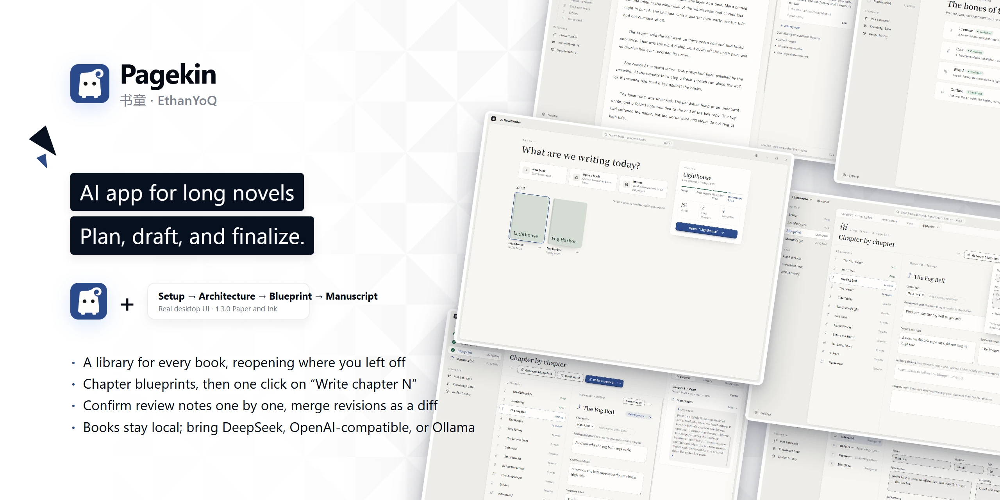
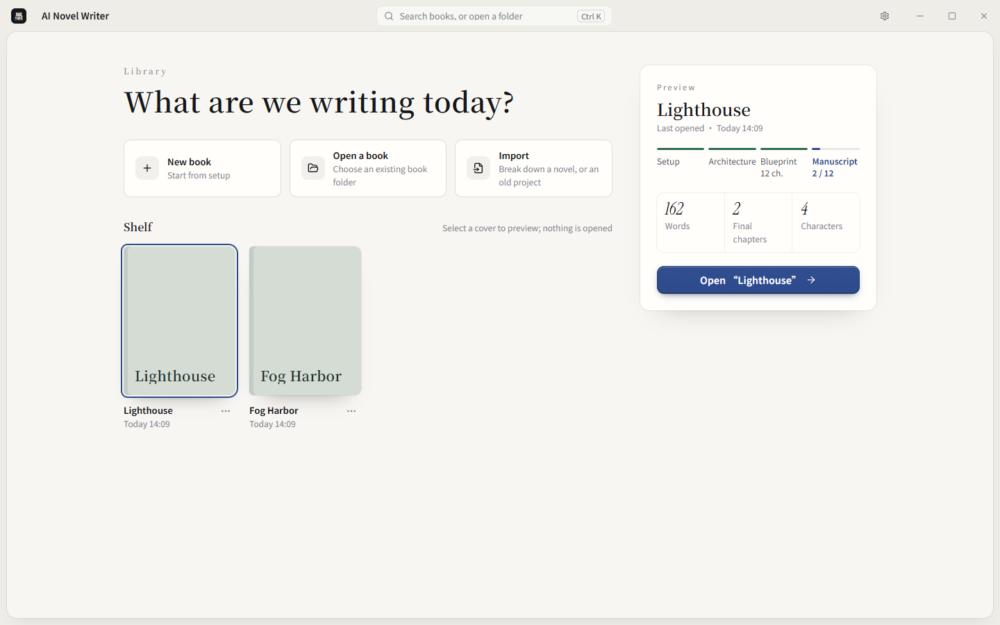
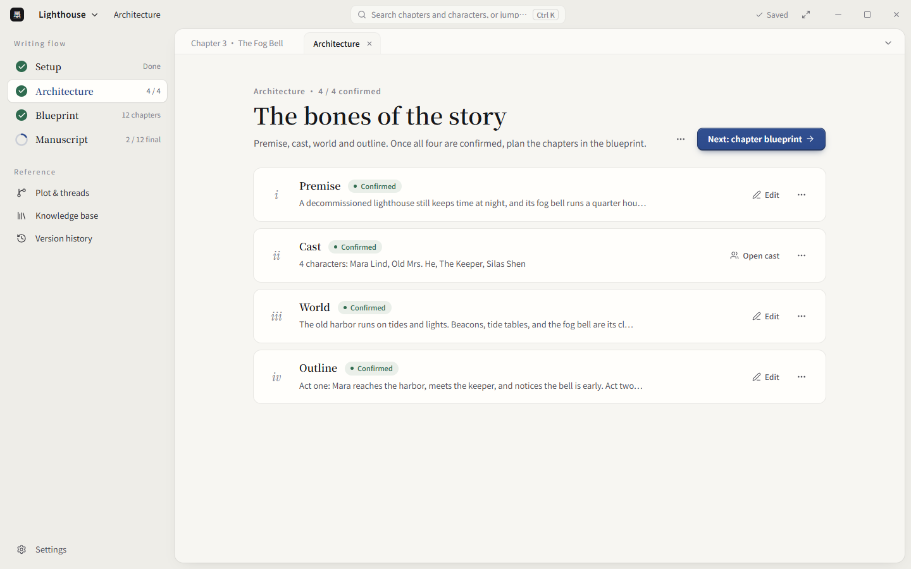
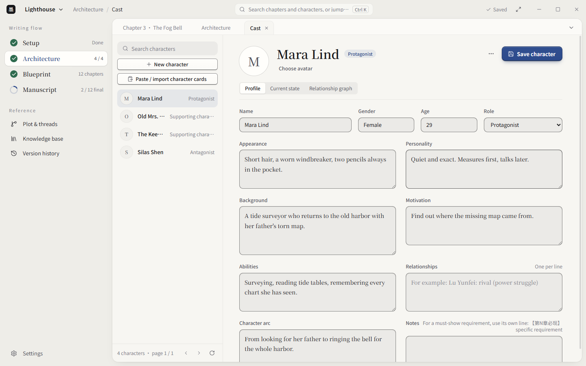
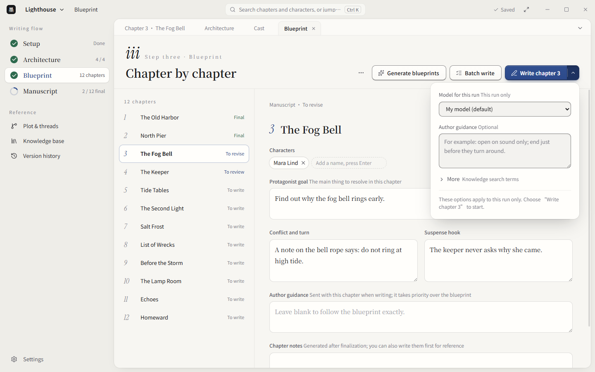
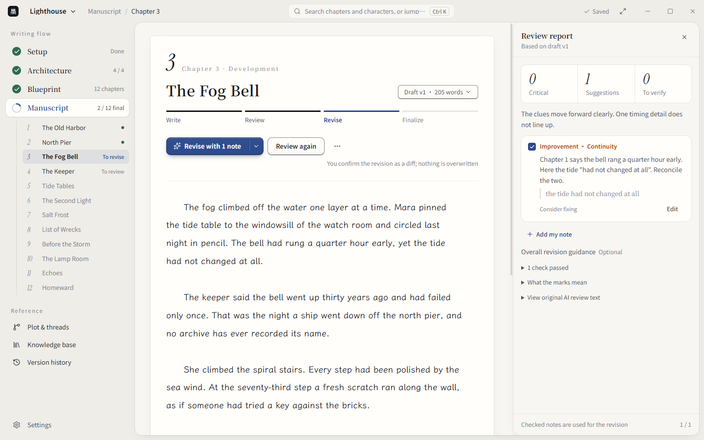
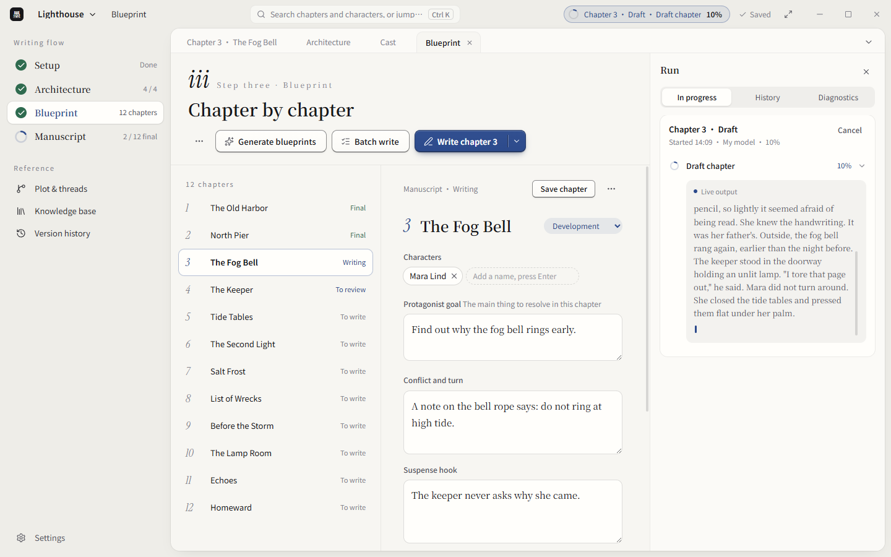
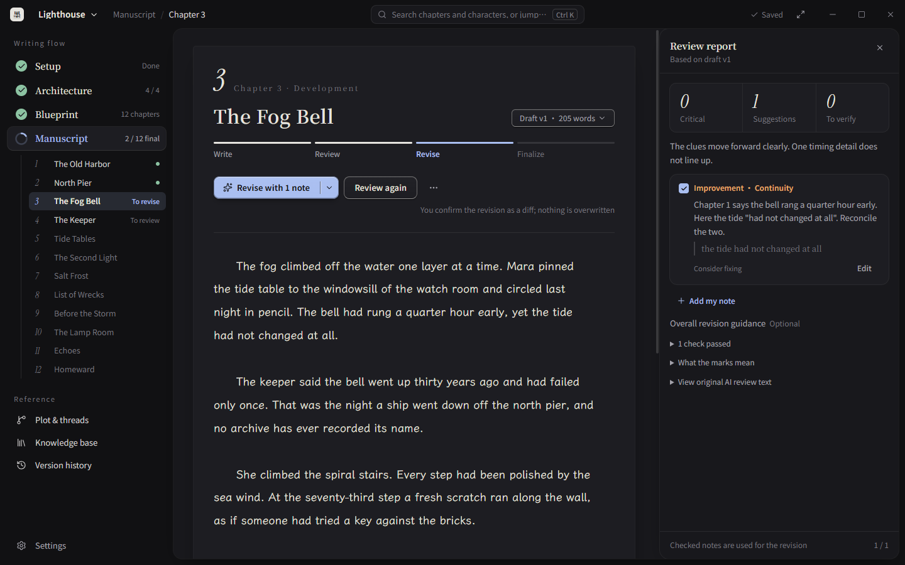

<div align="center">

[English](README_en.md) | [中文](README.md) | **日本語**

</div>

<p align="center">
  
</p>

<h1 align="center">Pagekin</h1>

<p align="center"><sub>旧名「AI Novel Writer」（AI 小说作家）。中国語名は 书童（「書生に仕える小姓」の意）です。</sub></p>

<p align="center">
  <strong>Pagekin は、無料の AI 小説執筆ソフトウェアです</strong><br />
  設定、ストーリー構成、章ブループリントから、下書き、レビュー、推敲、確定稿まで、1 章ずつ書き進められます。参考小説を分解してその文体を模倣したり、自分の原稿をインポートして続きを書いたり、自分の指示どおりに書き直したりすることもできます。<br />
  ローカルファースト：作品はあなた自身のコンピューターに保存されます。モデルは同梱していません。ご自身の API キーを使うか、Ollama でローカルモデルを実行してください。
</p>

Pagekin は EthanYoQ によってメンテナンスされています。[公式サイト](https://www.orz.md/en/ai-novel-writer/)では、製品概要、セットアップガイド、公式ダウンロードリンクを提供しています。

<p align="center">
  <a href="https://github.com/EthanYoQ/Pagekin/releases/latest"></a><br />
  <a href="https://www.orz.md/en/ai-novel-writer/#demo">実際のスクリーンショット付きの英語版初回利用ガイド</a><br />
  <sub>プロジェクトは手動でセットアップします。ローカルまたはクラウドのモデルはご自身で用意してください。</sub>
</p>

<p align="center">
  <a href="https://github.com/EthanYoQ/Pagekin/releases"></a>
  <a href="https://github.com/EthanYoQ/AI-Novel-Writer/blob/master/LICENSE"></a>
  <a href="https://github.com/EthanYoQ/AI-Novel-Writer/stargazers"></a>
</p>

<p align="center">
  
</p>

> ## 1.3.0 の新機能
>
> - インターフェース全体が新しい Paper and Ink 執筆インターフェースになり、設定、構成、ブループリント、原稿の順に整理されました。
> - 1 つの章が、未執筆から確定稿まで 1 ページで進みます：下書き、レビュー、推敲、統合、確定。
> - ブループリントページの「Write chapter N」は、大きなフォームではなく小さなポップオーバーを開くようになりました。
> - すべての生成実行が 1 つの実行シートに表示され、そこでキャンセル、バッチの一時停止、続行の確認ができます。
> - 外観はライトとダークのみになりました。アシスタントチャットの入口は当面非表示で、別途復活する予定です。
>
> 詳しくは [1.3.0 のリリースノート](https://github.com/EthanYoQ/Pagekin/releases/tag/v1.3.0)をご覧ください。

## できること

Pagekin は、小説が書かれる順序に沿って動作します。あなたが作者で、Pagekin はあなたに仕える小姓です。各ステップは本の中に保存され、次のステップに引き継がれます。AI が下書きを作り、あなたがすべてのステップを確認します。

### ライブラリ：すべての本を 1 か所に

ライブラリには、あなたが書いたすべての本が一覧表示されます。表紙を選ぶと、現在のステップ、文字数、確定済みの章、登場人物をプレビューできます。新しい本を始めたり、旧バージョンのプロジェクトのコピーをインポートしたりできます。



### 分解、模倣、続き書き、書き直し

ライブラリの「Novel breakdown & imitation」では、小説を .txt、.md、.epub ファイルとしてインポートし、章ごとに分割して、そのテキストの用途を尋ねます。

- **分解と模倣**：「Reference novel」を選びます。AI がその構成を分解し、文体を抽出し、章ブループリントを推定して、今後の執筆のための模倣ルールを作成します。参考小説はナレッジベースと分解結果にのみ取り込まれ、あなたの本文に混ざることはありません。
- **自分の原稿の続きを書く**：「My manuscript」を選びます。すでに書いた章は章番号ごとに確定稿としてインポートされ、AI はその登場人物と出来事をもとに続きの章を書きます。
- **一節の続きを書く**：本文エディターでテキストを選択し、ツールバーの Continue を選ぶと、AI がその一節から続きを書きます。
- **書き直し**：章全体を書き直すには Revise を使います。希望する方向性を書き、必要に応じてレビューの指摘にチェックを入れ、結果を原文と段落ごとに比較して、どちらのバージョンを残すかを選びます。短い一節の場合は、それを選択してツールバーの Refine、Expand、To dialogue を使います。

### 設定と構成：まず物語を組み立てる

設定ページには、ジャンル、対象読者、執筆言語、総章数、1 章あたりの文字数を記録します。構成ページには、前提、キャスト、世界観、プロットアウトラインの 4 つのセクションがあります。各セクションは AI に生成させることも、自分で書くこともできます。4 つすべてが確定したら、章ブループリントに進みます。



キャストは構成と並行して編集します。各キャラクターにはプロフィール、現在の状態、関係図があります。キャラクターカードを貼り付けたり、ファイルからインポートしたりできます。



### 章ブループリント：書く前に各章を計画する

ブループリントページでは、本を 1 章ずつ計画します。各章には、主人公の目標、葛藤と転換、サスペンスのフック、登場するキャラクターを記述します。AI は章の範囲ごとにブループリントを生成でき、中断された実行は続きから再開できます。

メインボタンは「Write chapter N」です。その横の小さなポップオーバーには、今回の実行のオプション（使用するモデルと、任意の一行の作者ガイダンス）だけが入っています。複数の章を続けて書くには「Batch write」を使います。一度に最大 10 章まで書けます。



### 原稿：下書き、レビュー、推敲、確定

単一章ビューでは、1 つの章を未執筆から確定稿まで仕上げます。AI が下書きを書いた後、自分で編集することも、AI にレビューを依頼することもできます。レビューレポートには各指摘が一覧表示されます。それぞれにチェックを入れるか無視するかを選び、自分の指摘を追加することもできます。推敲結果は差分として返され、段落ごとに確認するため、何も上書きされません。納得できたら、その章を確定します。



執筆中、AI が受け取るのは、その章のブループリント、関連するキャラクター、世界観、それまでの章の要約、直前の章の全文であり、本全体のチャット履歴ではありません。

本文エディターでは、Tab キーで段落の字下げとして全角スペースが 2 つ挿入されます。章全体をキーボードだけで書くことができます。

### 実行シート：AI が何をしているかを確認する

すべての生成実行は実行シートに表示され、In progress、History、Diagnostics のタブがあります。出力が書かれていく様子を見ながら、いつでもキャンセルできます。バッチは一時停止できます。実行が失敗した場合、それまでに書かれたテキストは復旧候補として保持され、コピーするか破棄するかを選べます。



### 参考資料とバージョン：長い本を見失わないために

- **プロットとスレッド**：メインプロット、サブプロット、伏線を章ごとに追跡し、各スレッドがどこで張られ、進展し、回収されたかを記録します。
- **ナレッジベース**：参考資料（.txt、.md）をインポートします。ローカルの全文検索は、検索用モデルがなくても動作します。
- **バージョン履歴**：章の過去のバージョンはすべて保持されます。現在の下書きと比較したり、新しい下書きとして復元したりできます。
- **エクスポートとバックアップ**：結合した Markdown、章ごとの Markdown ファイル、またはプレーンテキストとしてエクスポートできます。本をコンピューター上にアーカイブしたり、接続した WebDAV クラウドにバックアップしたりできます。復元すると、必ず新しいコピーが作成されます。

### 執筆スキル：自分の執筆ルールを持ち込む

「Writing skills」設定ページで、ローカルのスキルフォルダーか単一の SKILL.md を選ぶか、GitHub 上のスキルのアドレスを入力すると、プロンプトのみの執筆スキル（典型的な AI っぽい文体を取り除くもの、特定の文体やジャンル向けのものなど）をインポートできます。SKILL.md が参照する参考テキストファイルも含まれます。アプリはスキルを読み込み、インストール前にその内容を表示します。企画、下書き、レビュー、推敲のいずれかのステージに紐付けると、そのステージのすべての生成にスキルが含まれます。

サポートしているのは、自己完結した SKILL.md プロンプトのみです。スクリプト、フック、サブエージェント、ツール要件はインストールされないため、スキルがあなたのコンピューター上でコードを実行することはできません。

### ダークテーマと 2 つのインターフェース言語

外観はライトとダークから選べます。インターフェースは中国語と英語で利用できます。本の執筆言語は中国語または英語にできます。



## 対応モデルとサービス

Pagekin はモデルの提供や利用枠のホスティングを行いません。設定で、ご自身のサービスアドレス、モデル名、API キーを入力してください。2 つのリクエストプロトコルに対応しています：

- **OpenAI 互換**：Chat Completions API と互換性のある任意のサービス。
- **ネイティブ Gemini**：Google Gemini。

設定には、以下のプロバイダーのプリセットが含まれています：

| プロバイダー | プロトコル | 備考 |
| --- | --- | --- |
| DeepSeek | OpenAI 互換 | プリセットアドレス `https://api.deepseek.com` |
| SiliconFlow | OpenAI 互換 | プリセットアドレス `https://api.siliconflow.cn/v1` |
| BigModel (Zhipu) | OpenAI 互換 | プリセットアドレス `https://open.bigmodel.cn/api/paas/v4` |
| OpenAI | OpenAI 互換 | プリセットアドレス `https://api.openai.com` |
| xAI (Grok) | OpenAI 互換 | プリセットアドレス `https://api.x.ai/v1` |
| Google Gemini | ネイティブ Gemini | プリセットアドレス `https://generativelanguage.googleapis.com` |
| Ollama (local) | OpenAI 互換 | モデルはあなた自身のコンピューター上で動作します |
| NovelAI | OpenAI 互換 | 最小限の互換性のみで、実アカウントでの完全な検証はしていません |
| Custom | OpenAI 互換 | 任意の互換サービスアドレス |

「Custom」で変更できるのは、上記 2 つのプロトコルの範囲内でのアドレス、モデル名、認証情報のみです。任意の HTTP インターフェースではありません。Anthropic、Azure、ネイティブの KoboldAI などのインターフェースには専用のアダプターが必要で、URL を差し替えるだけでは動作しません。

ナレッジベースのセマンティック検索には別途埋め込みモデルが必要で、設定の「Retrieval model」で構成します。

### Ollama でローカルモデルを実行する

```text
Provider:  Ollama (local) or Custom
Protocol:  OpenAI-compatible
Base URL:  http://127.0.0.1:11434/v1
API key:   may be left blank; if the UI requires one, use any placeholder
Model:     your Ollama model name, for example qwen3:14b
```

埋め込みモデルも `/v1` のアドレスを使います。Ollama のネイティブインターフェースである `http://127.0.0.1:11434/api` は使わないでください。

## ダウンロードとインストール

公式インストーラーは [GitHub Releases](https://github.com/EthanYoQ/Pagekin/releases/latest) からのみダウンロードしてください。

### Windows x64

```text
ai-novel-writer-setup-<version>.exe
```

1. インストーラーを実行します。アップグレードで更新されるのはアプリケーションのみで、本、キャラクターカード、設定は削除されません。それでも、大切な作品は事前にバックアップしてください。
2. インストール後、「Settings → About & updates」でアップデートを確認できます。新しいバージョンはまず通知されます。「Download update」を選んだ場合にのみダウンロードされ、完了したら今すぐ再起動するか後で再起動するかを選びます。
3. 旧来のポータブル ZIP ビルドは、アップデーターを自動的に取得できません。一度だけ公式インストーラーを手動でインストールしてください。

現在、インストーラーにはコード署名がされていません。Windows で発行元不明の警告が表示される場合があります。ダウンロードページがこのリポジトリの公式 GitHub Release であることを確認してから続行してください。

### macOS (Apple Silicon と Intel)

```text
ai-novel-writer-mac-arm64-<version>-installer.dmg
ai-novel-writer-mac-x64-<version>-installer.dmg
```

1. `arm64` は Apple Silicon 搭載の Mac（M1、M2、M3、M4 以降）向け、`x64` は Intel 搭載の Mac 向けです。
2. DMG からアプリを Applications にドラッグして起動します。アプリは新しいバージョンを通知しますが、macOS では自身をダウンロードしたり置き換えたりしません。アップデートすると公式の Release ページが開き、お使いのアーキテクチャ向けのインストーラーをダウンロードできます。
3. どちらのインストーラーも ad-hoc 署名のみで、Developer ID 署名はなく、公証もされていません。Gatekeeper にアプリがブロックされた場合は、このリポジトリの公式 GitHub Release から入手したものであることを確認してから、Finder でアプリを Control キーを押しながらクリックして「開く」を選ぶか、「システム設定 → プライバシーとセキュリティ」で許可してください。

## データとプライバシー

| データまたは動作 | 保存場所または送信先 |
| --- | --- |
| 本、キャラクター、ブループリント、下書き、確定稿 | あなたの本のフォルダーと、ローカルの SQLite データベース。 |
| 失敗した実行からの復旧候補 | 現在の本のローカルデータベースのみ。勝手に下書きや確定稿になることはありません。 |
| インポートした参考資料 | クラウドモデルに送信しない限り、ローカルの本の中にとどまります。 |
| ローカルモデルへのリクエスト | 設定したローカルまたは LAN 上の推論サービスに送信されます。 |
| クラウドモデルへのリクエスト | プロンプトとコンテキストは、選択したプロバイダーに送信されます。 |
| モデル設定と API キー | アプリデータディレクトリの `ai-novel-writer` フォルダー（Windows では `%APPDATA%\ai-novel-writer`、macOS では `~/Library/Application Support/ai-novel-writer`）に保存されます。OS のアカウントを保護し、このフォルダーを共有しないでください。 |
| アプリの環境設定 | モデル設定と同じフォルダーに保存されます。 |

以前のバージョンでは、設定を `~/.vela` に保存していました。現在のバージョンは起動時にそれらを上記のフォルダーへコピーし、元のファイルには手を加えません。

アプリは、モデルアカウント、クラウド生成、プロモーションメッセージを提供しません。アップデートの確認では、公開されている GitHub Releases のみを読み取ります。

## よくある質問

**Pagekin は無料ですか？**
はい。GPL-3.0 ライセンスのオープンソースです。クラウドモデルの呼び出しにかかる費用は、あなたとモデルプロバイダーとの間の問題です。Ollama 経由のローカルモデルであれば、プロバイダーは一切不要です。

**どのモデルが必要ですか？**
OpenAI 互換の Chat Completions API で提供されている任意のモデルが使え、Google Gemini はネイティブプロトコルを使います。設定には DeepSeek、SiliconFlow、Zhipu、OpenAI、xAI、Gemini、Ollama、NovelAI のプリセットが含まれています。出力の品質は選択したモデルによって異なります。アプリはモデルの出力について一切保証しません。

**データはどこに保存されますか？**
あなた自身のコンピューター上の、本のフォルダーとローカルの SQLite データベースです。関連するプロンプト、物語の設定、コンテキストは、生成を開始したときにのみ、設定したモデルサービスに送信されます。

**小説はどのくらいの長さにできますか？**
総章数は自分で設定でき、固定の上限はありません。各章について、AI はその章のブループリント、関連するキャラクター、世界観、それまでの章の要約、直前の章の全文を受け取るため、本全体を 1 つの会話に収める必要はありません。Batch write は 1 回の実行で最大 10 章を処理し、実行を重ねて書き続けることができます。

**英語での執筆に対応していますか？**
はい。インターフェースは中国語と英語で利用でき、各本の執筆言語は中国語または英語にできます。

**旧バージョンのプロジェクトを 1.3.0 にアップグレードするにはどうすればよいですか？**
1.1.0 または 1.2.x をインストールしている場合は、アプリ内アップデーターでアップグレードしてください（macOS では新しいインストーラーを手動でダウンロードします）。アップグレードしても本は変更されず、旧来の外観設定はライトまたはダークに移行されます。旧プロジェクトを新しい形式に変換するには、ライブラリで「Import」を選び、次に「Import an old project copy」を選びます。インポートすると新しいコピーが作成され、元のプロジェクトには手が加えられません。

**AI っぽい文体を取り除くスキルなどをインポートできますか？**
はい。「Writing skills」設定ページで、ローカルのスキルフォルダーか SKILL.md を選ぶか、スキルの GitHub アドレスを入力し、内容を確認してからインストールし、下書きや推敲などのステージに紐付けます。サポートしているのはプロンプトのみの SKILL.md ファイルで、スクリプトがインストールされたり実行されたりすることはありません。

**アシスタントチャットはどこに行きましたか？**
1.3.0 の新しいインターフェースでは、アシスタントチャットの入口を当面非表示にしています。別途復活する予定です。下書き、レビュー、推敲などのワークフローには影響ありません。

**Windows や macOS でインストーラーが安全ではないと表示されます。どうすればよいですか？**
Windows のインストーラーは署名されておらず、Mac のインストーラーは ad-hoc 署名のみで Apple による公証も受けていないため、システムが警告を表示します。インストーラーがこのリポジトリの公式 GitHub Release から入手したものであることを確認したうえで、「ダウンロードとインストール」の手順に従って許可してください。

## 現在の制限

- URL とキーだけでは、サードパーティの API が動作することは保証されません。サポートしているのは、実装済みのプロトコルとプリセットのみです。
- アプリは、あなたの創作上の判断、事実確認、著作権に関する判断の代わりにはなりません。AI が書いたものはすべて確認してください。
- オンライン出版、読者コミュニティ、クラウドモデルアカウントは提供していません。

## ソースからビルドする

Node.js 22.14 以降と、リポジトリで固定されている pnpm のバージョンが必要です。

```sh
git clone https://github.com/EthanYoQ/AI-Novel-Writer.git
cd AI-Novel-Writer
pnpm install --frozen-lockfile
pnpm dev
```

公式インストーラーは GitHub Actions でビルドされます。Windows x64、macOS Apple Silicon、macOS Intel の各インストーラーは、それぞれの検証に合格したうえで 1 つの GitHub Release に掲載されます。ドキュメントの権威、ADR、開発ルールについては [`docs/README.md`](docs/README.md) をご覧ください。ロゴ、カラー、デザインファイルは[ブランドキット](docs/brand/README.md)（中国語）にまとめられています。

## コントリビューション

バグの報告や機能のリクエストは [GitHub Issues](https://github.com/EthanYoQ/AI-Novel-Writer/issues) で、使い方に関する質問は [Discussions](https://github.com/EthanYoQ/AI-Novel-Writer/discussions) でお願いします。プルリクエストを作成する前に [CONTRIBUTING.md](CONTRIBUTING.md) をお読みください。これは公開リポジトリのため、提出するものから API キー、小説の全文、ローカルのパスを取り除いてください。

## DeepSeek Harness プラグイン（凍結）

このリポジトリには、DeepSeek Harness 向けの Web プラグインである `@ethanyoq/dsh-ai-novel-writer` `0.1.0` の開発者プレビューも含まれています。このプラグインは凍結されており、短期的な機能開発の予定はありません。デスクトップアプリケーションの機能の 10% 未満しか備えておらず、デスクトップのプロジェクトを読み込まず、デスクトップアプリの代わりにもなりません。[npm](https://www.npmjs.com/package/@ethanyoq/dsh-ai-novel-writer) で MIT ライセンスのもと別途公開されています。インストールと使い方については[プラグインの README](plugins/dsh-ai-novel-writer/README.md) をご覧ください。

## ライセンス

デスクトップアプリケーションは [GPL-3.0](LICENSE) ライセンスのもとでオープンソースとして公開されています。
