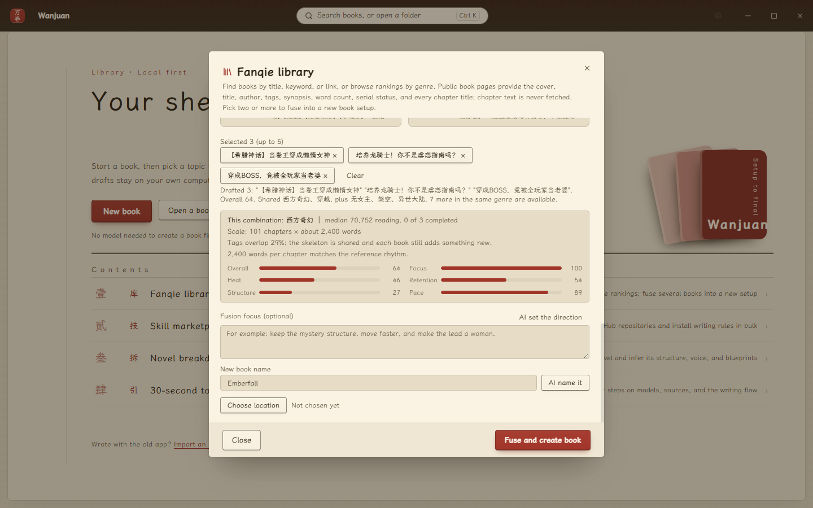
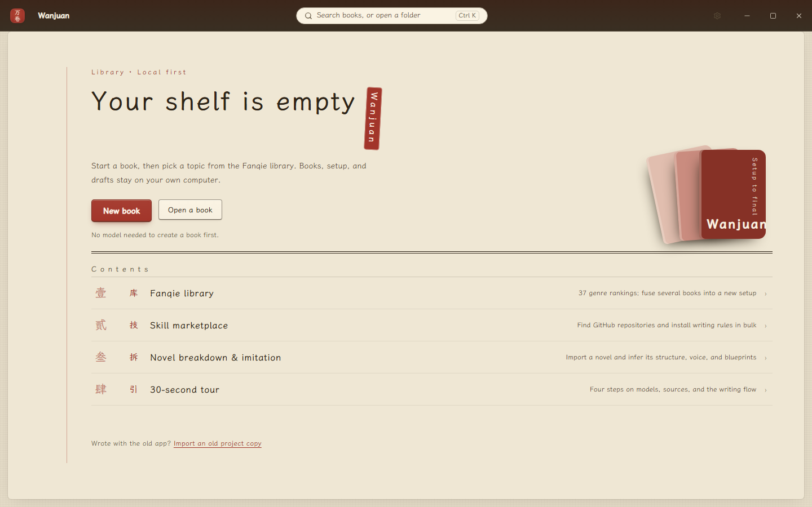

<div align="center">

[English](README_en.md) | [中文](README.md) | **日本語**

</div>

<p align="center">
  
</p>

<h1 align="center">万卷 Wanjuan</h1>

<p align="center"><sub>ローカルファーストの長編執筆デスク。題材選びから確定稿まで</sub></p>

<p align="center">
  <a href="https://github.com/1210350468/wanjuan/releases/latest"></a>
  <a href="LICENSE"></a>
  
  
</p>

<p align="center">
  <strong>無料・オープンソースの AI 小説執筆ソフト。題材選び、設定、構成、章ブループリント、本文、レビュー、推敲、確定稿までを 1 冊の中で完結させます。</strong><br />
  作品はあなたのコンピューターに保存されます。モデルは同梱していません。ご自身の API キーを使うか、Ollama でローカルモデルを動かしてください。
</p>

万卷は Pagekin（旧名 书童）から派生したプロジェクトです。元の執筆フローをそのまま残し、番茄（Fanqie）書庫からの題材探し、複数作品の融合、Skill マーケット、初回ガイドを加えています。上流プロジェクトは [EthanYoQ/Pagekin](https://github.com/EthanYoQ/Pagekin)、著作権とライセンスは [NOTICE.md](NOTICE.md) をご覧ください。

## 3 分で始める

| 手順 | やること |
|---|---|
| 1. インストール | [Releases](https://github.com/1210350468/wanjuan/releases/latest) から `wanjuan-setup-<バージョン>.exe`（Windows）またはお使いのアーキテクチャの `.dmg`（macOS）を入手します。インストーラーはコード署名されていないため、配布元不明の警告が出たら[インストール手順](#ダウンロードとインストール)に従って許可します。 |
| 2. モデルを設定 | 「設定 → AI モデル」でプロバイダーのプリセット（DeepSeek、Zhipu、SiliconFlow など）を選び、API キーとモデル名を入力して「接続テスト」を押します。費用をかけない場合は [Ollama](#ollama-でローカルモデルを動かす)から始められます。 |
| 3. 作品を作る | 書斎（ライブラリ）に戻り「新規作品」を選び、名前と保存先を決めます。ジャンル、総章数、1 章あたりの文字数は設定ページで入力します。 |
| 4. 確定稿まで書く | 「設定 → 構成 → ブループリント → 本文」の順に進みます。どの段階も AI に下書きさせ、あなたが確認します。本文が書けたらレビュー、推敲、確定を行います。 |

初回起動時には、モデル・参考資料・執筆順を説明する 4 ステップのガイドが表示されます。空の書斎にある「30 秒でわかる」からいつでも見直せます。

<p align="center">
  
</p>

## 万卷で収益化する

ウェブ小説で稼ぐ道は限られており、差がつくのは生産量と題材選びです。万卷はどの段階でも具体的な時間を節約します。

| ルート | 収入源 | 万卷が助けるところ |
|---|---|---|
| **無料閲覧プラットフォームのレベニューシェア** | 番茄、七猫などは閲覧時間と広告から分配し、契約者は原稿料を受け取る | 番茄書庫で男性向け・女性向けのランキングをそのまま確認でき、題材選びが勘に頼らずに済む。一括ブループリントで毎日更新を途切れさせない |
| **有料購読のレベニューシェア** | 起点、晋江などは購読、月間票、投げ銭から分配 | 章ブループリントで各章の葛藤とフックを先に固め、レビュー報告が指摘ごとに意見を返すので、品質が安定して配信しやすい |
| **皆勤賞と最低保証** | プラットフォームが毎日の更新文字数に応じて賞与を出し、契約者には最低保証がある | 「一括執筆」で最大 10 章を一度に下書きでき、毎日のノルマを徹夜で埋めなくて済む |
| **ショートドラマ・オーディオブック化** | 権利元が買い取りまたは分配で支払う | ブループリントのフックは改編側が求める要素そのもの。伏線ページでどの伏線がどの章にあるか一目で分かる |
| **ゴーストライティング・制作会社の受注** | 千字単位の報酬、制作会社は量産 | クライアントの原稿を取り込んで続きを書き、文体を分解して模倣でき、同時に複数作品を進められる |
| **ニュースレター・コラム連載** | WeChat 公式アカウントや知乎コラムが記事単位・購読単位で支払う | ヒット作の構造を分解してブループリントに逆算し、ジャンルの書き方を素早く掴める |

実際に始められるルート：

1. 「番茄書庫 → 分類ランキング」で 2〜3 ジャンルのランキングを見て、ランクイン作品が多く、自分も書けるジャンルを選びます。
2. 「おまかせで一組」で同じジャンルの 3 冊を組んでもらい、診断（ジャンル、規模、テンポ）を確認してから「AI に方針を決めさせる」で新しい作品の設定を生成します。参考作品はジャンルと構造の根拠だけを与え、人物・地名・筋書きはすべて新しく作られます。
3. まず 10 章までを試験的に書きます。ブループリントは 10 章単位で生成し、本文は一括執筆でつなげ、章ごとにレビューと推敲を行います。
4. その 10 章をプラットフォームへ投稿するか、そのまま連載を始め、継読データを見て更新を増やすか決めます。数字が振るわなければジャンルを変えてやり直し、失うのは 10 日だけです。

収益が得られるかどうかは作品そのものとプラットフォームの規約によります。万卷が高めるのは生産量と題材選びの命中率であり、収益を約束するものではありません。AI 生成コンテンツの扱いはプラットフォームごとに異なるため、公開前に必ず投稿先の作者規約をご確認ください。

<p align="center">
  
</p>

<p align="center">
  
</p>

## 書斎：すべての作品を 1 か所で

書斎には、あなたが書いたすべての作品が並びます。表紙を選ぶと、現在の段階、本文の文字数、確定済みの章、登場人物を確認できます。新しい作品を始めることも、旧バージョンのプロジェクトをコピーとして取り込むこともできます。

初回起動時は空の書斎です。左に「新規作品」と「作品を開く」、下の目次に番茄書庫、Skill マーケット、小説の分解と模倣、30 秒ガイドの 4 行が並び、選んだ先へ移動できます。旧バージョンで書いたことがある場合は、下部の注記からそのプロジェクトのコピーを取り込めます。

<p align="center">
  
</p>

## 初回でつまずきやすいところ

| 症状 | 対処 |
|---|---|
| インストール時に「配布元不明」と出る | インストーラーはコード署名されていません。このリポジトリの Release から入手したことを確認し、「詳細情報 → 実行」を選びます。macOS はアプリを Control キーを押しながらクリックして「開く」を選びます。 |
| 「接続テスト」が失敗する | まず Base URL のパスを確認します。DeepSeek や OpenAI などは各ドキュメントの正確なパス（多くは `/v1` で終わる）が必要です。API キーに空白や引用符を入れないでください。 |
| Ollama の 11434 に繋がらない | Ollama が起動しているか（`ollama list` が結果を返すか）を確認し、Base URL は `http://127.0.0.1:11434/v1` を指定します。`/api` は使いません。 |
| 本文執筆が進まない、章が空になる | 実行シートでそのタスクを見ます。モデルの応答待ちか、利用枠やコンテキスト長で拒否されていないかを確認します。失敗時はそれまでに書かれた文が復旧候補として残ります。 |
| 出力がイメージと違う | まずブループリントの葛藤とフックを直します。モデルの変更はその後です。ブループリントが曖昧なら、どのモデルでも曖昧な章になります。 |

## できること

万卷は小説が書かれる順序に沿って動作します。あなたが作者で、万卷はあなたに仕える小姓です。各ステップの結果は作品に保存され、次のステップに引き継がれます。AI が下書きを作り、あなたがすべてのステップを確認します。

### 番茄書庫：題材探しと複数作品の融合

タイトル、キーワード、書籍リンクから番茄の作品を探せます。男性向け 19、女性向け 18 のジャンルランキングをたどることもでき、各ジャンルのランクイン作品が表紙、あらすじ、文字数、連載状況とともに並びます。読むのは公開されている書籍詳細ページのみで、表紙、タイトル、作者、タグ、あらすじ、文字数、連載状況、全章タイトルを取得します。章の本文は取得しません。

1 冊ずつ選ぶのが面倒なら「おまかせで一組」を押します。ジャンルの骨格、章のテンポ、読者数から現在の候補を 3 冊選び、共通ジャンルと各書が持ち込む新しさを説明します。2〜5 冊選ぶと診断パネルが出て、どのジャンルか、どの規模で書くか（章数 × 1 章あたりの文字数）、タグの重なり、テンポが主流より速いか遅いかが分かります。さらに 0〜100 の採点が出ます。総合と、ジャンルのまとまり、人気、継読、構造、テンポの 5 項目です。候補カードの右上にはその本の総合点が表示されるので、選ぶ前に見比べられます。「AI に選ばせる」を押すと、候補のタグ、読者数、規模、状態、採点をモデルに渡し、どの 2〜3 冊を融合するか、なぜか、どの方向で書くかをモデル自身が判断します。選べないときは明確にエラーを出し、その場しのぎの組み合わせは作りません。融合の方針は自分で書くことも、「AI に方針を決めさせる」で 2 案を出して 1 案をクリックで入れることもできます。作品名も「AI で命名」で候補を出せます。保存先を決めて名前を確認し、「融合して新規作品を作成」を押すと、アプリが作品を作成し、参考作品の中央値から総章数と 1 章あたりの文字数を決め、AI に設定、構成、主要プロットを生成させます。参考作品はジャンルと構造の根拠だけを与え、融合結果がその人物、地名、具体的な筋書きを再現することはありません。

採点はその場で決めた重みではなく、各項目に根拠があります。

| 項目 | 単冊の重み | 組の重み | 計算方法 | 根拠 |
| --- | --- | --- | --- | --- |
| 人気 | 30% | 22% | `log10(読者数)` を 10³〜10⁷ から 0〜100 に写す | 読者数はロングテールなので、対数尺度が体感に合う |
| 継読 | 20% | 16% | 章あたり読者を `(v·R + m·C)/(v+m)` で縮小し、対数で 0〜100 に | IMDb 加重評価：10 章で 100 万人が 1000 章で 100 万人に勝つべきではない |
| 構造 | 25% | 20% | 完結 100、連載は章数で 20〜90、不明は 40 | 連載長と完結状態が、参考にできる量を決める |
| テンポ | 25% | 20% | `exp(−δ²/2σ²)`、δ は 1 章あたり文字数の 3000 からの対数距離、σ=0.5 | ガウスカーネル：主流から外れるほど滑らかに減衰する |
| ジャンルのまとまり | — | 22% | タグ同士の Jaccard の平均。0.15 未満は 45、0.6 超は 55 に下げる | 集合の内聚性：散らばりすぎても似すぎても良くない |

組の人気・継読・構造・テンポは各冊の**中央値**なので、1 冊の不出来で組全体が崩れることはありません。縮小の事前分布は 300 章・1 章 300 人で、「標本が少なければプラットフォーム平均へ寄せる」定石です。最適化された値ではありませんが、どの数字も説明できます。

キーワード検索は Bing のサイト内検索で書籍 ID を特定します。検索サービスが使えない場合はランキング内のタイトル一致に切り替わり、書籍リンクを直接貼ることもできます。

### 分解・模倣・続き書き・書き直し

書斎の「小説の分解と模倣」では、.txt、.md、.epub の小説を取り込み、章ごとに分割し、そのテキストの用途を尋ねます。

- **分解と模倣**：「参考小説」を選びます。AI が構成を分解し、文体を抽出し、章ブループリントを逆算して、今後の執筆のための模倣制約を作ります。参考小説はナレッジベースと分解結果にのみ入り、本文に混ざることはありません。
- **原稿の続きを書く**：「自分の原稿」を選びます。すでに書いた章は章番号ごとに確定稿として取り込まれ、AI はその人物と出来事を受け継いで次の章を書きます。
- **一節の続きを書く**：本文エディターでテキストを選択し、ツールバーの「続きを書く」を選ぶと、AI がその一節から先を書きます。
- **書き直し**：章全体を書き直すときは「推敲」を使います。直したい方向を書き、必要ならレビューの指摘にチェックを入れ、結果を原文と段落ごとに比較して採用する版を選びます。短い一節なら、選択してツールバーの推敲・拡張・会話文に変換を使います。

### 設定と構成：まず物語を組み立てる

設定ページではジャンル、対象読者、執筆言語、総章数、1 章あたりの文字数を記録します。構成ページは、前提、キャスト、世界観、プロットの 4 節に分かれます。どの節も AI に生成させるか自分で書けます。4 節すべてを確定したら、章ブループリントに進みます。

キャストは構成と並んで編集します。各キャラクターには基本設定、現在の状態、関係図があります。キャラクターカードは貼り付けもファイルからの取り込みもできます。

### 章ブループリント：書く前に各章を決める

ブループリントページでは、作品を章ごとに計画します。各章には主人公の小さな目標、葛藤と転換、サスペンスのフック、登場人物を書きます。AI は章の範囲を指定して分割生成でき、中断しても続きから再開できます。

メインボタンは「第 N 章を書く」です。隣の小さなポップオーバーには、今回の実行のオプション（使うモデル、任意の作者指示 1 行）だけが入っています。続けて複数章を書くときは「一括執筆」を使います。一度に最大 10 章までです。

### 本文：下書き、レビュー、推敲、確定

単一章ビューでは、1 章を未執筆から確定稿まで進めます。AI が下書きを書いた後は、自分で編集することも、AI にレビューを依頼することもできます。レビュー報告は指摘を 1 件ずつ並べるので、採用するか無視するかを選び、自分の意見も追加できます。推敲の結果は差分として返り、段落ごとに確認するため、元の原稿が上書きされることはありません。納得したら確定します。

執筆中に AI が受け取るのは、その章のブループリント、関連するキャラクター、世界観、前の章までの要約、直前の章の全文であり、作品全体のチャット履歴ではありません。

本文エディターでは、Tab キーで段落の字下げとして全角スペースが 2 つ入ります。1 章をキーボードだけで書き切れます。

### 実行シート：AI が何をしているか見る

生成タスクはすべて実行シートに集まり、進行中・履歴・診断の 3 つのタブがあります。書かれていく出力をリアルタイムで見て、いつでも中止できます。一括執筆は一時停止できます。失敗した場合、それまでに書かれたテキストは復旧候補として残り、コピーするか破棄するかを選べます。

### 作品資料とバージョン：長編で伏線を失わない

- **プロットと伏線**：本筋、サブプロット、伏線の進み具合を章ごとに確認し、各伏線がどの章で張られ、進展し、回収されたかを記録します。
- **ナレッジベース**：参考資料（.txt、.md）を取り込みます。検索用モデルがなくてもローカルの全文検索が使えます。
- **バージョン履歴**：章の過去の原稿はすべて残ります。現在の原稿と比較したり、新しい下書きとして戻したりできます。
- **エクスポートとバックアップ**：結合 Markdown、章ごとの Markdown、TXT として書き出せます。作品をこのコンピューターにまとめるか、接続した WebDAV クラウドにバックアップできます。復元は常に新しいコピーとして保存されます。

### 執筆スキル：自分の執筆ルールを持ち込む

設定の「執筆スキル」ページで、ローカルのスキルフォルダーか単一の SKILL.md を選ぶか、GitHub 上のスキルのアドレスを入力すると、プロンプトのみの執筆スキル（AI っぽさを消すもの、特定の文体やジャンルの書き方など）を取り込めます。SKILL.md が参照するテキストも一緒に取り込まれます。インストール前に内容を読み込んで表示するので、確認してから決められます。インストール後は企画・執筆・レビュー・推敲のいずれかの段階に紐付けると、その段階の生成すべてに反映されます。

「Skill マーケット」を押すと、内蔵の推荐元を自動でスキャンしてインストール可能なスキルを一覧表示し、「インストール可能なものを一括で入れる」も選べます。GitHub のリポジトリのアドレスを貼って個別にスキャンすることも、キーワードでリポジトリを検索して選ぶこともできます。検索結果には説明、スター数、最終更新日が付き、いずれもその場で GitHub から読み取ります。各行にはスキルの段階、言語、同梱テキストの数、インストールできない理由（スクリプト、フック、サブエージェント、結合後 64 KiB 超）が表示されます。同じリポジトリから導入済みのものは「インストール済み」と表示されます。

対応するのは自己完結した SKILL.md のプロンプトのみです。スクリプト、フック、サブエージェント、ツール呼び出しはインストールされないため、スキルがあなたのコンピューター上でコードを実行することはありません。

### ダークテーマと 2 つの表示言語

外観には、明るい「古い紙」と暗い「夜の読書」の 2 種類があります。インターフェースは中国語と英語に対応しています。作品の執筆言語も中国語か英語を選べます。

## 対応モデルとサービス

万卷はモデルを提供せず、利用枠の管理も行いません。設定でご自身のサービスアドレス、モデル名、API キーを入力します。対応する呼び出し方法は 3 つです。

- **OpenAI 互換**：Chat Completions API と互換性のある任意のサービス。
- **ネイティブ Gemini**：Google Gemini。
- **ローカル実行器（CLI）**：すでにログインしている `codex`、`gemini`、`claude` などのコマンドライン agent をそのまま呼びます。

設定には以下のプロバイダーのプリセットがあります。

| プロバイダー | プロトコル | 備考 |
| --- | --- | --- |
| DeepSeek | OpenAI 互換 | プリセットアドレス `https://api.deepseek.com` |
| SiliconFlow | OpenAI 互換 | プリセットアドレス `https://api.siliconflow.cn/v1` |
| BigModel (Zhipu) | OpenAI 互換 | プリセットアドレス `https://open.bigmodel.cn/api/paas/v4` |
| OpenAI | OpenAI 互換 | プリセットアドレス `https://api.openai.com` |
| xAI (Grok) | OpenAI 互換 | プリセットアドレス `https://api.x.ai/v1` |
| Google Gemini | ネイティブ Gemini | プリセットアドレス `https://generativelanguage.googleapis.com` |
| Ollama (local) | OpenAI 互換 | モデルはあなた自身のコンピューター上で動作します |
| NovelAI | OpenAI 互換 | 最小限の互換性のみで、実アカウントでの完全な検証はしていません |
| ローカル実行器（CLI） | CLI | すでにログインしている `codex`、`gemini`、`claude` を呼びます。API キーは不要 |
| Custom | OpenAI 互換 | 任意の互換サービスアドレス |

「Custom」で変更できるのは、OpenAI 互換またはネイティブ Gemini の範囲内でのアドレス、モデル名、認証情報のみです。任意の HTTP インターフェースではありません。Anthropic、Azure、ネイティブの KoboldAI などのインターフェースには専用のアダプターが必要で、URL を差し替えるだけでは動作しません。

ナレッジベースのセマンティック検索には別途埋め込みモデルが必要で、設定の「検索モデル」で構成します。

### 契約中の CLI を実行器として使う

API キーの代わりに、すでにログインしているコマンドライン agent をそのまま呼べます。ChatGPT を契約していれば `codex`、Google アカウントがあれば `gemini`、Claude なら `claude` を指定します。いずれも自分の契約枠を使うので、別のキーは要りません。

```text
設定 → AI モデル → 新規 → プロバイダー: ローカル実行器（CLI）
実行器:  Codex / Gemini CLI / Claude Code / agy / カスタム
コマンド: codex
引数:    exec {{prompt}}
```

引数に `{{prompt}}` を書くとその位置にプロンプトが入り、書かなければ標準入力から渡します。実行器には system ロールがないため、メッセージは順番に連結されます。token 使用量は返らないので本文生成の集計はその分欠けますが、选题、タイトル、方向づけのような小さい作業に向いています。

<p align="center">
  
</p>

### Ollama でローカルモデルを動かす

```text
プロバイダー: Ollama (local) または Custom
プロトコル:   OpenAI 互換
Base URL:     http://127.0.0.1:11434/v1
API キー:     空でも可。UI が要求する場合は任意のプレースホルダーを入力
モデル:       お使いの Ollama モデル名（例: qwen3:14b）
```

埋め込みモデルも `/v1` のアドレスを使います。Ollama のネイティブインターフェースである `http://127.0.0.1:11434/api` は使わないでください。

## ダウンロードとインストール

インストーラーはこのリポジトリの [Releases](https://github.com/1210350468/wanjuan/releases/latest) で公開しています。

### Windows x64

```text
wanjuan-setup-<バージョン>.exe
```

1. インストーラーを実行します。アップグレードで更新されるのはアプリケーションのみで、作品、キャラクターカード、設定は削除されません。それでも大切な作品は事前にバックアップしてください。
2. インストール後、「設定 → このアプリについて」でアップデートを確認できます。新しいバージョンはまず通知され、「アップデートをダウンロード」を選んだ場合にのみダウンロードが始まり、完了後に今すぐ再起動するか後で再起動するかを選びます。
3. 旧来のポータブル ZIP ビルドはアップデーターを自動取得できません。一度だけ正式なインストーラーを手動で入れてください。

現在、インストーラーはコード署名されていません。Windows が配布元不明の警告を出すことがあります。ダウンロードページがこのリポジトリの公式 GitHub Release であることを確認してから続行してください。

### macOS（Apple Silicon と Intel）

```text
wanjuan-mac-arm64-<バージョン>-installer.dmg
wanjuan-mac-x64-<バージョン>-installer.dmg
```

1. `arm64` は Apple Silicon 搭載の Mac（M1、M2、M3、M4 以降）向け、`x64` は Intel 搭載の Mac 向けです。
2. DMG のアプリを「アプリケーション」にドラッグして起動します。アプリは新しいバージョンを通知しますが、macOS では自動でダウンロードも置き換えも行いません。更新時は公式の Release ページを開き、お使いのアーキテクチャ向けのインストーラーを手動でダウンロードします。
3. どちらのインストーラーも ad-hoc 署名のみで、Developer ID 署名も公証もありません。Gatekeeper がブロックした場合は、このリポジトリの公式 GitHub Release から入手したものであることを確認したうえで、Finder でアプリを Control キーを押しながらクリックして「開く」を選ぶか、「システム設定 → プライバシーとセキュリティ」で許可してください。

## データとプライバシー

| データまたは動作 | 保存場所または送信先 |
| --- | --- |
| 作品、キャラクター、ブループリント、下書き、確定稿 | あなたの作品フォルダーとローカルの SQLite データベース。 |
| 失敗した実行からの復旧候補 | 現在の作品のローカルデータベースのみ。勝手に下書きや確定稿になることはありません。 |
| 取り込んだ参考資料 | クラウドモデルに送信しない限り、ローカルの作品内にとどまります。 |
| ローカルモデルへのリクエスト | 設定したローカルまたは LAN 上の推論サービスに送信されます。 |
| クラウドモデルへのリクエスト | プロンプトとコンテキストは、選択したプロバイダーに送信されます。 |
| モデル設定と API キー | アプリデータディレクトリの `ai-novel-writer` フォルダー（Windows は `%APPDATA%\ai-novel-writer`、macOS は `~/Library/Application Support/ai-novel-writer`）に保存されます。OS のアカウントを保護し、このフォルダーを共有しないでください。 |
| アプリの環境設定 | モデル設定と同じフォルダーに保存されます。 |

以前のバージョンは設定を `~/.vela` に保存していました。現在のバージョンは起動時に上記のフォルダーへコピーし、元のディレクトリには手を加えません。

アプリ自体は、モデルのアカウント、クラウド生成サービス、運用上の通知を提供しません。アップデートの確認は公開されている GitHub Release を読むだけです。

## よくある質問

**万卷は無料ですか？**

無料です。GPL-3.0 ライセンスでオープンソース公開しています。クラウドモデルの呼び出し費用は、あなたとモデルプロバイダーの間で精算されます。Ollama のローカルモデルなら、どのプロバイダーにも費用を払う必要はありません。

**万卷で書いた小説の著作権は誰のものですか？**

あなたのものです。ソフトウェアは作品に対していかなる権利も主張せず、どこかへアップロードすることもありません。AI が下書きし、あなたが修正した部分も同じくあなたのものです。最終的には公開先プラットフォームの作者規約に従います。

**どのモデルが必要ですか？**

OpenAI 互換の Chat Completions API を持つモデルなら何でも使え、Google Gemini はネイティブプロトコルで接続します。設定には DeepSeek、SiliconFlow、Zhipu、OpenAI、xAI、Gemini、Ollama、NovelAI のプリセットがあります。生成品質は選んだモデルによります。ソフトウェアはモデルの出力品質を保証しません。

**データはどこに保存されますか？**

あなた自身のコンピューターです。作品フォルダーとローカルの SQLite データベースに保存されます。生成を開始したときにだけ、関連するプロンプト、作品設定、コンテキストが設定したモデルサービスへ送信されます。

**どのくらいの長さの小説が書けますか？**

総章数は設定で決められ、固定の上限はありません。各章を書くとき、AI が受け取るのはその章のブループリント、関連するキャラクター、世界観、前の章までの要約、直前の章の全文なので、作品全体を 1 回の会話に収める必要はありません。一括執筆は 1 回で最大 10 章、何度でも続けて書けます。

**英語で書けますか？**

書けます。インターフェースは中国語と英語があり、作品の執筆言語も中国語か英語を選べます。

**旧バージョンのプロジェクトはどうやって移行しますか？**

1.1.0 または 1.2.x をインストール済みの場合は、アプリ内アップデーターで更新できます（macOS は新しいインストーラーを手動でダウンロード）。更新しても作品データは変わらず、旧来の外観設定はライトまたはダークに自動移行されます。旧形式のプロジェクトを新しい形式に変換するには、書斎で「取り込み」を選び、「旧プロジェクトのコピーを取り込む」を選びます。取り込みは新しいコピーを作り、元のプロジェクトには手を加えません。

**スキルを取り込めますか。たとえば AI っぽさを消すものなど。**

取り込めます。設定の「執筆スキル」ページでローカルのスキルフォルダーか SKILL.md を選ぶか、GitHub 上のスキルのアドレスを入力し、内容を確認してからインストールし、執筆や推敲などの段階に紐付けます。対応するのはプロンプトのみの SKILL.md で、スクリプトのインストールや実行は行いません。

**アシスタントチャットはどこへ行きましたか？**

現在のインターフェースでは、アシスタントチャットの入口を当面非表示にしています。別途復活させる予定です。執筆、レビュー、推敲など他の機能には影響ありません。

**Windows や macOS でインストーラーが安全ではないと表示されます。どうすればよいですか？**

Windows のインストーラーは署名されておらず、Mac のインストーラーは ad-hoc 署名のみで Apple の公証も受けていないため、システムが警告を出します。インストーラーがこのリポジトリの公式 GitHub Release から入手したものであることを確認したうえで、上記「ダウンロードとインストール」の手順に従って許可してください。

## 現在の制限

- URL とキーだけで任意のサードパーティ API が動くことは保証しません。保証するのは実装済みのプロトコルとプリセットのみです。
- 作者の創造性、事実確認、著作権の判断を代替するものではありません。AI が書いた内容は必ず確認してください。
- オンライン公開、読者コミュニティ、クラウドモデルのアカウントは提供しません。

## ソースからビルドする

Node.js 22.14 以降と、リポジトリで固定されているバージョンの pnpm が必要です。

```sh
git clone https://github.com/1210350468/wanjuan.git
cd wanjuan
pnpm install --frozen-lockfile
pnpm dev
```

正式なインストーラーは GitHub Actions でビルドされます。Windows x64、macOS Apple Silicon、macOS Intel の 3 つのインストーラーは、それぞれの適格性チェックを通ったうえで 1 つの GitHub Release に掲載されます。ドキュメントの権威、ADR、開発ルールは [`docs/README.md`](docs/README.md) をご覧ください。ロゴ、配色、デザインファイルは[ブランドキット](docs/brand/README.md)（中国語）にまとめています。

## コントリビューション

バグと機能提案は [GitHub Issues](https://github.com/1210350468/wanjuan/issues) へ、使い方の質問は [Discussions](https://github.com/1210350468/wanjuan/discussions) へお願いします。プルリクエストの前に [CONTRIBUTING.md](CONTRIBUTING.md) をお読みください。公開リポジトリのため、投稿する内容から API キー、小説の全文、ローカルのパスを取り除いてください。

## DeepSeek Harness プラグイン（凍結）

リポジトリには、DeepSeek Harness 向けの Web プラグイン `@ethanyoq/dsh-ai-novel-writer` `0.1.0` の開発者プレビューも残しています。このプラグインは凍結されており、短期的な機能拡張の予定はありません。デスクトップ版の機能の 10% 未満しか持たず、デスクトップ版のプロジェクトを読み込まず、デスクトップ版の代わりにもなりません。MIT ライセンスで [npm](https://www.npmjs.com/package/@ethanyoq/dsh-ai-novel-writer) に別途公開しています。インストールと使い方は[プラグインの README](plugins/dsh-ai-novel-writer/README.md) をご覧ください。

## ライセンス

デスクトップアプリケーションは [GPL-3.0](LICENSE) ライセンスでオープンソース公開しています。
