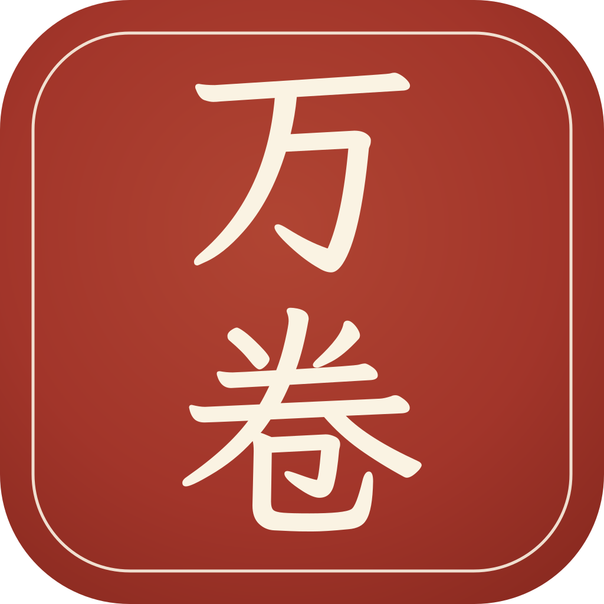
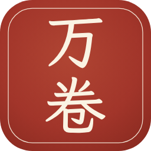
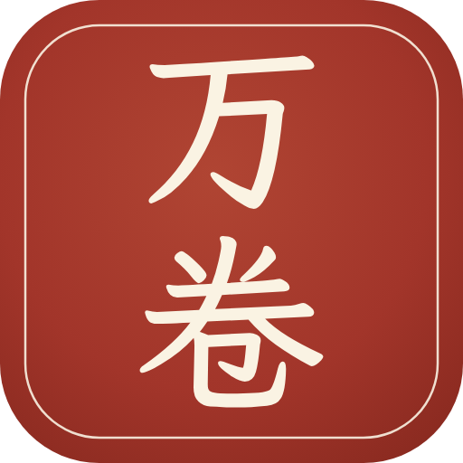
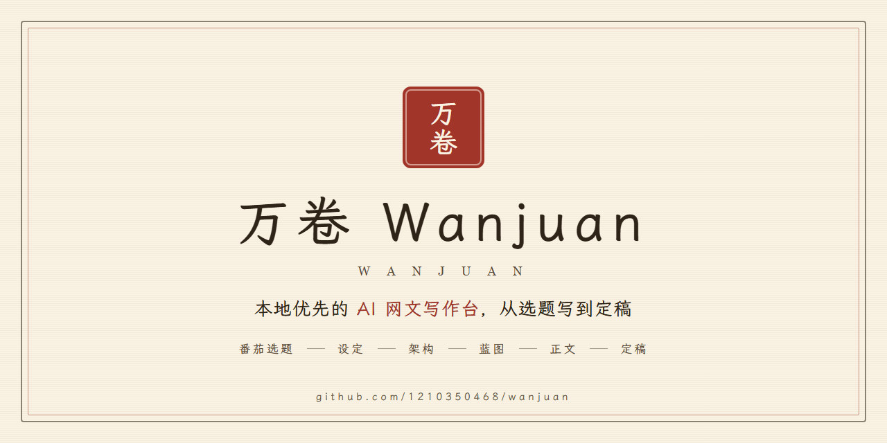
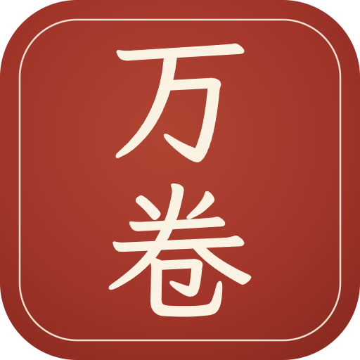

# 书童品牌包

本页是书童品牌元素的唯一入口：名称、Logo、配色、字体、设计稿和使用约束。素材都在仓库里，本页只做索引，不另存副本。克隆仓库或在 GitHub 上下载源码压缩包，就能取回全部文件。

## 名称

| 项 | 值 | 来源 |
| --- | --- | --- |
| 中文名 | 书童 | [ADR-0022](../adr/0022-product-name-shutong-keeps-legacy-identity.md) |
| 英文名 | Pagekin | [v1.3.1 更新说明](../../.release/notes/v1.3.1.md) |
| 中英合写 | 书童 Pagekin（快捷方式、「应用和功能」、窗口标题） | [`electron-builder.json5`](../../electron-builder.json5) 的 `shortcutName`，[`index.html`](../../index.html) 的 `<title>` |
| 原名 | AI 小说作家 / AI Novel Writer | [v1.3.1 更新说明](../../.release/notes/v1.3.1.md) |
| Logo 名 | 书页精灵，形象是一张卷起页角的纸和两只圆眼睛 | [v1.3.1 更新说明](../../.release/notes/v1.3.1.md)，[README](../../README.md) 的 Logo 替代文字 |

改名只改了显示名。下面的标识沿用旧名，不能改，理由见 [ADR-0022](../adr/0022-product-name-shutong-keeps-legacy-identity.md)。

| 标识 | 值 |
| --- | --- |
| `appId` | `com.ai-novel-writer.app` |
| `package.json` 的 `name` | `ai-novel-writer` |
| 设置目录 | Windows 为 `%APPDATA%\ai-novel-writer`，macOS 为 `~/Library/Application Support/ai-novel-writer` |
| 全局数据目录的默认名 | `ai-novel-writer-data` |
| 仓库地址（自动更新也用它） | `1210350468/wanjuan` |

## Logo

万卷的应用图标是一枚朱砂方印：底色沿用 `--accent` 的浅色值 `#A2352A`（带径向明暗），竖排「万卷」与内框线是 `--paper` 的浅色值 `#FAF3E3`。字形路径从 `public/fonts/LXGWWenKai-Medium.ttf` 用 fontTools 烘成 SVG path，图标不依赖运行环境的字体。上游书页精灵（Pagekin）的旧标识保留在 `pagekin-*` 各文件里，出处见文件末尾的设计溯源。

| 预览 | 文件 | 用途 |
| --- | --- | --- |
|  | [`wanjuan-icon.svg`](../assets/brand/wanjuan-icon.svg) | 应用图标的矢量母版，1024×1024。`build/` 下的打包图标与 `public/wanjuan-icon.svg`（README 顶部 Logo）都由它生成 |
|  | [`wanjuan-icon-256.png`](../assets/brand/wanjuan-icon-256.png) | 日文 README 顶部 Logo |
|  | [`wanjuan-icon-512.png`](../assets/brand/wanjuan-icon-512.png) | 高分辨率导出，用于分享与文档 |
|  | [`pagekin-icon.svg`](../assets/brand/pagekin-icon.svg) | 上游书页精灵的图标母版，1024×1024，保留作出处；`build/` 图标不再由它生成 |
|  | [`pagekin-mark-blue.svg`](../assets/brand/pagekin-mark-blue.svg) | 单色标识，黛蓝 `#2C4A8C`，用于浅色底 |
|  | [`pagekin-mark-ink.svg`](../assets/brand/pagekin-mark-ink.svg) | 单色标识，墨色 `#17171A`，用于浅色底 |
|  | [`pagekin-mark-paper.svg`](../assets/brand/pagekin-mark-paper.svg) | 单色标识，纸色 `#FFFEFB`，用于深色底。GitHub 浅色主题下这一格看起来是空白 |
|  | [`src/assets/brand/pagekin-mark.svg`](../../src/assets/brand/pagekin-mark.svg) | 应用内副本，与 `pagekin-mark-ink.svg` 逐字节相同。顶栏和「关于与更新」用它做 CSS 遮罩，颜色随主题 |
|  | [`social-preview.png`](../assets/brand/social-preview.png) | 1280×640 社交预览图。仓库里没有引用它，按尺寸推断用于 GitHub 仓库设置里的 Social preview |
|  | [`build/icon.png`](../../build/icon.png) | 窗口图标，512×512 |
| 无预览 | [`build/icon.ico`](../../build/icon.ico) | Windows 安装包与 exe 图标，含 16 至 256 像素共 7 个尺寸 |
| 无预览 | [`build/icon.icns`](../../build/icon.icns) | macOS 应用图标，按 macOS 图标网格四周留白 |

要重新生成 `build/` 下的三个图标，运行 `npx electron scripts/brand/build-app-icons.mjs`。脚本见 [`build-app-icons.mjs`](../../scripts/brand/build-app-icons.mjs)。

### README 主视觉

README 当前的主视觉是 [`hero-zh-retro.png`](../assets/readme/hero-zh-retro.png) 和 [`hero-en-retro.png`](../assets/readme/hero-en-retro.png)（1280×460），分别由 [`hero-zh-retro.html`](../readme-visuals/hero-zh-retro.html)、[`hero-en-retro.html`](../readme-visuals/hero-en-retro.html) 合成；GitHub Social preview 是 [`social-preview.png`](../assets/brand/social-preview.png)（1280×640），源文件 [`social-preview-retro.html`](../readme-visuals/social-preview-retro.html)。

正文里的界面截图分两套，都是 1440×900 的完整窗口截图：

| 目录 | 界面语言 | 用在哪 |
| --- | --- | --- |
| [`docs/assets/readme/retro/`](../assets/readme/retro/) | 中文 | `README.md` |
| [`docs/assets/readme/retro-en/`](../assets/readme/retro-en/) | 英文 | `README_en.md`、`README_ja.md` |

两套都含 `library.png`、`guide.png`、`settings.png`、`fanqie.png`、`fanqie-rank.png`、`fanqie-fusion.png`。截图清单与合成方式见 [`visual-manifest.json`](../readme-visuals/visual-manifest.json)。改文案或改界面后要重拍，否则图里的按钮名会和界面不一致。

改名前后的旧主视觉（`v130-hero-*.webp`、`hero-*-v2.png`）保留在仓库里备查，README 已不再引用。

### 改名前的旧素材

下列文件是改名前「AI 小说作家」时期的素材，README 已不再使用，保留在仓库里备查。

| 预览 | 文件 | 说明 |
| --- | --- | --- |
|  | [`ai-novel-writer-logo-transparent.png`](../assets/readme/ai-novel-writer-logo-transparent.png) | 旧 Logo（蓝色羽毛笔），不是书页精灵。2026-07-19 由提交 `fbe41e09` 加入，早于 2026-10-18 的改名提交 `88fb1ad7` |
| 无预览 | [`hero-zh.svg`](../assets/readme/hero-zh.svg)、[`hero-en.svg`](../assets/readme/hero-en.svg) | 旧主视觉，SVG 标题仍是「AI 小说作家」 |
| 无预览 | [`hero-zh-v2.png`](../assets/readme/hero-zh-v2.png)、[`hero-en-v2.png`](../assets/readme/hero-en-v2.png)、[`hero-captures/zh/`](../assets/readme/hero-captures/zh/)、[`hero-captures/en/`](../assets/readme/hero-captures/en/) | 旧主视觉的位图版和它用的截图 |
| 无预览 | [`v130-hero-zh.webp`](../assets/readme/v130-hero-zh.webp)、[`v130-hero-en.webp`](../assets/readme/v130-hero-en.webp)、[`v130-*.webp`](../assets/readme/) | 1.3.0 时期的拼图主视觉与正文截图，复古改版后由 `retro/`、`retro-en/` 两套取代 |

改名前的应用图标没有留在当前目录里。要取回，运行 `git show 895e01f1:build/icon.png`（`icon.ico`、`icon.icns` 同理）。

## 配色与令牌

以源码为准。源文件是 [`src/styles/paper-ink/tokens.css`](../../src/styles/paper-ink/tokens.css)，它是渲染进程里唯一允许写颜色值的文件。下表由 [`paper-ink-tokens.mjs`](../../scripts/brand/paper-ink-tokens.mjs) 从源文件生成，不要手改。

- 改了 `tokens.css` 后，运行 `node scripts/brand/paper-ink-tokens.mjs --write` 重新生成。
- 运行 `node scripts/brand/paper-ink-tokens.mjs --check` 核对本表与源码一致、本页的相对链接都能解析。不一致时退出码为 1。

用途取自 [`design-system.md`](../design/2026-10-11-frontend-redesign/design-system.md) 的「令牌」表和 `tokens.css` 的注释。`primitives.css` 里的 `--pi-*` 是组件内部变量，不是令牌，不列在表里。

<!-- paper-ink-tokens:start -->

共 101 个令牌，其中 50 个在深色主题里改了值。「同浅色」表示深色沿用左列的写法；写法里引用的令牌按深色的值计算。

### 表面

| 令牌 | 浅色 | 深色 | 用途 |
| --- | --- | --- | --- |
| `--frame` | `#E3DAC6` | `#16110C` | 应用底（外框） |
| `--sunken` | `rgba(46, 36, 24, .06)` | `rgba(0, 0, 0, .28)` | 凹陷输入 |
| `--surface` | `#EFE7D4` | `#1E1812` | 悬浮面板 |
| `--surface-2` | `#E7DDC6` | `#2A2119` | 悬停与选中 |
| `--paper` | `#FAF3E3` | `#221B14` | 正文纸面 |

### 墨色

| 令牌 | 浅色 | 深色 | 用途 |
| --- | --- | --- | --- |
| `--ink` | `#2E2418` | `#EAE0CC` | 正文与标题 |
| `--ink-2` | `#5A4C38` | `#B3A58C` | 次要文字 |
| `--ink-3` | `#6A5B48` | `#97896E` | 说明文字 |
| `--ink-4` | `#A8997F` | `#675A44` | 禁用与占位，只用于占位符、分隔与装饰 |

### 线

| 令牌 | 浅色 | 深色 | 用途 |
| --- | --- | --- | --- |
| `--rule` | `rgba(46, 36, 24, .08)` | `rgba(255, 244, 220, .08)` | 分隔线 |
| `--rule-strong` | `rgba(46, 36, 24, .16)` | `rgba(255, 244, 220, .16)` | 控件边框 |
| `--track` | `rgba(46, 36, 24, .11)` | `rgba(255, 244, 220, .1)` | 进度轨道 |

### 强调（黛蓝）

用途：主操作、当前位置、键盘焦点。

| 令牌 | 浅色 | 深色 |
| --- | --- | --- |
| `--accent` | `#A2352A` | `#E2A860` |
| `--accent-hover` | `#83241C` | `#EDBC7E` |
| `--accent-ink` | `#FFF8EC` | `#1C150E` |
| `--accent-soft` | `rgba(162, 53, 42, .09)` | `rgba(226, 168, 96, .14)` |
| `--accent-line` | `rgba(162, 53, 42, .4)` | `rgba(226, 168, 96, .45)` |
| `--accent-track` | `rgba(162, 53, 42, .2)` | `rgba(226, 168, 96, .22)` |

### 语义

用途：完成、提醒、危险，与强调色色相不同。

| 令牌 | 浅色 | 深色 |
| --- | --- | --- |
| `--ok` | `#4E6B45` | `#9FC48B` |
| `--ok-soft` | `rgba(78, 107, 69, .1)` | `rgba(159, 196, 139, .14)` |
| `--warn` | `#A96820` | `#E0B070` |
| `--warn-soft` | `rgba(169, 104, 32, .1)` | `rgba(224, 176, 112, .14)` |
| `--danger` | `#9E2B20` | `#E89080` |
| `--danger-ink` | `#FFF8EC` | `#1C150E` |
| `--danger-soft` | `rgba(158, 43, 32, .08)` | `rgba(232, 144, 128, .14)` |
| `--danger-line` | `rgba(158, 43, 32, .5)` | `rgba(232, 144, 128, .55)` |

### 焦点环、阴影与遮罩

用途：焦点环、按钮与面板投影、模态遮罩。

| 令牌 | 浅色 | 深色 |
| --- | --- | --- |
| `--focus-ring` | `0 0 0 2px var(--paper), 0 0 0 4px var(--accent)` | 同浅色 |
| `--shadow-button` | `0 1px 2px rgba(46, 36, 24, .2)` | `0 1px 2px rgba(0, 0, 0, .42)` |
| `--shadow-panel` | `0 0 0 1px rgba(46, 36, 24, .09), 0 8px 24px -12px rgba(46, 36, 24, .18)` | `0 0 0 1px rgba(255, 244, 220, .07), 0 12px 32px -16px rgba(0, 0, 0, .72)` |
| `--shadow-pop` | `0 0 0 1px rgba(46, 36, 24, .1), 0 16px 40px -12px rgba(46, 36, 24, .3)` | `0 0 0 1px rgba(255, 244, 220, .09), 0 20px 48px -12px rgba(0, 0, 0, .68)` |
| `--shadow-seg` | `0 1px 2px rgba(46, 36, 24, .12)` | `0 1px 2px rgba(0, 0, 0, .5)` |
| `--scrim` | `rgba(30, 22, 12, .4)` | `rgba(0, 0, 0, .58)` |

### 浮层

用途：菜单、弹层、通知、对话框共用的浮笺。

| 令牌 | 浅色 | 深色 |
| --- | --- | --- |
| `--layer` | `var(--paper)` | 同浅色 |
| `--shadow-dialog` | `0 0 0 1px rgba(46, 36, 24, .1), 0 2px 6px -2px rgba(46, 36, 24, .1), 0 28px 56px -24px rgba(30, 22, 12, .48)` | `0 0 0 1px rgba(255, 244, 220, .09), 0 2px 6px -2px rgba(0, 0, 0, .52), 0 32px 72px -24px rgba(0, 0, 0, .82)` |

### 材质

用途：按钮与输入框的受光、边线、投影、内凹与薄雾，从基础令牌用 color-mix 派生。

| 令牌 | 浅色 | 深色 |
| --- | --- | --- |
| `--accent-edge` | `color-mix(in srgb, var(--accent) 70%, var(--ink))` | `color-mix(in srgb, var(--accent) 62%, var(--frame))` |
| `--accent-press` | `color-mix(in srgb, var(--accent-hover) 82%, var(--ink))` | `color-mix(in srgb, var(--accent) 84%, var(--frame))` |
| `--accent-base` | `color-mix(in srgb, var(--accent) 56%, var(--ink))` | `color-mix(in srgb, var(--accent) 48%, var(--frame))` |
| `--accent-top` | `color-mix(in oklab, var(--accent) 96%, #FFF8EC)` | 同浅色 |
| `--accent-hover-top` | `color-mix(in oklab, var(--accent-hover) 96%, #FFF8EC)` | 同浅色 |
| `--hi` | `rgba(255, 252, 240, .32)` | `rgba(255, 244, 220, .5)` |
| `--paper-hi` | `rgba(255, 252, 240, .92)` | `rgba(255, 244, 220, .07)` |
| `--paper-top` | `var(--paper)` | `color-mix(in oklab, var(--paper) 97%, var(--ink))` |
| `--paper-foot` | `color-mix(in oklab, var(--paper) 98.5%, var(--ink))` | `var(--paper)` |
| `--paper-edge` | `color-mix(in srgb, var(--ink) 18%, transparent)` | `rgba(0, 0, 0, .55)` |
| `--paper-press` | `var(--surface-2)` | `color-mix(in srgb, var(--paper) 55%, var(--frame))` |
| `--edge` | `color-mix(in srgb, var(--ink) 49%, transparent)` | `color-mix(in srgb, var(--ink) 40%, transparent)` |
| `--edge-strong` | `color-mix(in srgb, var(--ink) 66%, transparent)` | `color-mix(in srgb, var(--ink) 56%, transparent)` |
| `--lift` | `rgba(46, 36, 24, .18)` | `rgba(0, 0, 0, .5)` |
| `--lift-soft` | `rgba(46, 36, 24, .12)` | `rgba(0, 0, 0, .4)` |
| `--lift-accent` | `color-mix(in srgb, var(--accent-edge) 72%, transparent)` | `rgba(0, 0, 0, .55)` |
| `--sink` | `rgba(46, 36, 24, .2)` | `rgba(0, 0, 0, .45)` |
| `--wash` | `color-mix(in srgb, var(--ink) 6%, transparent)` | `color-mix(in srgb, var(--ink) 7%, transparent)` |
| `--wash-strong` | `color-mix(in srgb, var(--ink) 11%, transparent)` | `color-mix(in srgb, var(--ink) 12%, transparent)` |
| `--danger-edge` | `color-mix(in srgb, var(--danger) 70%, transparent)` | 同浅色 |
| `--danger-hover` | `color-mix(in srgb, var(--danger) 86%, var(--ink))` | 同浅色 |
| `--danger-press` | `color-mix(in srgb, var(--danger) 74%, var(--ink))` | `color-mix(in srgb, var(--danger) 80%, var(--frame))` |

### 字体

| 令牌 | 浅色 | 深色 | 用途 |
| --- | --- | --- | --- |
| `--font-ui` | `"LXGW WenKai", "Noto Serif SC", "Songti SC", "SimSun", serif` | 同浅色 | 界面无衬线 |
| `--font-display` | `"LXGW WenKai", "Noto Serif SC", "Songti SC", "SimSun", serif` | 同浅色 | 标题衬线 |
| `--font-prose` | `"LXGW WenKai", "Noto Serif SC", "Songti SC", "SimSun", serif` | 同浅色 | 正文衬线 |
| `--font-num` | `"Instrument Serif", Georgia, serif` | 同浅色 | 章节号与统计数字 |
| `--font-mono` | `"JetBrains Mono", ui-monospace, Consolas, monospace` | 同浅色 | 诊断等宽 |

### 字号

用途：9 级字号阶梯；正文字号、行高与行宽。

| 令牌 | 浅色 | 深色 |
| --- | --- | --- |
| `--fs-11` | `11px` | 同浅色 |
| `--fs-12` | `12px` | 同浅色 |
| `--fs-13` | `13px` | 同浅色 |
| `--fs-14` | `14px` | 同浅色 |
| `--fs-16` | `16px` | 同浅色 |
| `--fs-20` | `20px` | 同浅色 |
| `--fs-24` | `24px` | 同浅色 |
| `--fs-30` | `30px` | 同浅色 |
| `--fs-36` | `36px` | 同浅色 |
| `--prose-size` | `18px` | 同浅色 |
| `--prose-lh` | `2.05` | 同浅色 |
| `--prose-measure` | `34em` | 同浅色 |

### 间距

用途：4px 的倍数。

| 令牌 | 浅色 | 深色 |
| --- | --- | --- |
| `--s-1` | `4px` | 同浅色 |
| `--s-2` | `8px` | 同浅色 |
| `--s-3` | `12px` | 同浅色 |
| `--s-4` | `16px` | 同浅色 |
| `--s-5` | `20px` | 同浅色 |
| `--s-6` | `24px` | 同浅色 |
| `--s-8` | `32px` | 同浅色 |
| `--s-10` | `40px` | 同浅色 |
| `--s-12` | `48px` | 同浅色 |
| `--s-16` | `64px` | 同浅色 |

### 圆角

用途：控件、面板与胶囊的圆角。

| 令牌 | 浅色 | 深色 |
| --- | --- | --- |
| `--radius-sm` | `2px` | 同浅色 |
| `--radius` | `3px` | 同浅色 |
| `--radius-control` | `4px` | 同浅色 |
| `--radius-lg` | `5px` | 同浅色 |
| `--radius-panel` | `6px` | 同浅色 |
| `--radius-pill` | `999px` | 同浅色 |

### 布局

用途：侧页宽度与内容区最小宽度。

| 令牌 | 浅色 | 深色 |
| --- | --- | --- |
| `--sheet-w` | `380px` | 同浅色 |
| `--sheet-w-wide` | `620px` | 同浅色 |
| `--content-min-w` | `600px` | 同浅色 |

### 动效

用途：只用于状态变化。

| 令牌 | 浅色 | 深色 |
| --- | --- | --- |
| `--ease` | `cubic-bezier(.2, .8, .2, 1)` | 同浅色 |
| `--dur-fast` | `140ms` | 同浅色 |
| `--dur` | `220ms` | 同浅色 |

### 层级

用途：侧页、弹层、遮罩、对话框、命令式弹窗、提示栈的叠放顺序。

| 令牌 | 浅色 | 深色 |
| --- | --- | --- |
| `--z-sheet` | `5` | 同浅色 |
| `--z-popover` | `15` | 同浅色 |
| `--z-scrim` | `10010` | 同浅色 |
| `--z-dialog` | `10011` | 同浅色 |
| `--z-prompt` | `10012` | 同浅色 |
| `--z-toast` | `10020` | 同浅色 |

<!-- paper-ink-tokens:end -->

## 字体与排版

规定见 [`design-system.md`](../design/2026-10-11-frontend-redesign/design-system.md) 的「字体」一节，字体声明见 [`fonts.css`](../../src/styles/paper-ink/fonts.css)。

| 用处 | 字体 | 字号与排版 |
| --- | --- | --- |
| 界面 | Noto Sans SC | 13px 为基准 |
| 标题与阶段名 | Noto Serif SC 600 | 按 `--fs-*` 阶梯 |
| 正文 | Noto Serif SC | 18px，行高 2.05，每行约 34 字，首行缩进两字 |
| 数字 | Instrument Serif 斜体 | 用于章节号与统计数字 |
| 诊断等宽 | JetBrains Mono | `fonts.css` 没有内置它，未安装时回退到系统等宽字体 |

- 内置字体都随安装包分发，不联网加载。字体文件和许可在 [`public/fonts/`](../../public/fonts/)。
- 外观设置里还能选 Inter 作界面字体、霞鹜文楷（LXGW WenKai）作写作字体，两者也已内置。
- 单章视图的章节头有登记过的例外字号，见 `design-system.md`「字体」一节。

## 设计稿

设计稿都在 [`docs/design/2026-10-11-frontend-redesign/`](../design/2026-10-11-frontend-redesign/)。

| 路径 | 内容 |
| --- | --- |
| [`design-system.md`](../design/2026-10-11-frontend-redesign/design-system.md) | 纸墨设计系统：视觉基准、设计理念、令牌、字体、组件、材质和验收规则 |
| [`claude-design/`](../design/2026-10-11-frontend-redesign/claude-design/) | 视觉基准。Claude Design 画布 7 块画板的源文件（`.dc.html`），只能在 Design 画布里渲染 |
| [`prototype/`](../design/2026-10-11-frontend-redesign/prototype/) | 高保真静态原型，每屏一个 HTML，用于确认信息架构和状态覆盖 |
| [`directions/`](../design/2026-10-11-frontend-redesign/directions/) | 设计方向比稿页和截图 |
| [`review/`](../design/2026-10-11-frontend-redesign/review/) | 各阶段实现的评审截图和录屏 |
| [`ia.md`](../design/2026-10-11-frontend-redesign/ia.md) | 信息架构与已确认的决定 |
| [`feature-matrix.md`](../design/2026-10-11-frontend-redesign/feature-matrix.md) | 功能保全矩阵 |
| [`plan.md`](../design/2026-10-11-frontend-redesign/plan.md) | 重做的实施计划 |

## 使用约束

下面几条在项目里已有规定，这里只做汇总。

| 约束 | 来源 |
| --- | --- |
| 颜色只用纸墨令牌。组件只引用令牌，不自己定义颜色 | `design-system.md`「令牌」一节；`tokens.css` 文件头注释 |
| `src/components` 和纸墨样式目录里不写十六进制、rgb、hsl 颜色字面量 | `design-system.md` 验收规则第 6 条；[`check-color-literals.mjs`](../../scripts/check-color-literals.mjs)，`pnpm lint` 会运行它 |
| 黛蓝是唯一的强调色，只标记主操作、当前位置和键盘焦点 | `design-system.md`「设计理念」一节 |
| 图标用 lucide，不用 emoji 或文字符号充当图标 | [`package.json`](../../package.json) 依赖 `lucide-react`；[整合合同](../plans/novel-quality-program-v3-2026-09-13/05-INTEGRATION-CONTRACT.md)「图标沿用lucide，不新增Emoji/手写SVG图标」；[原型说明](../design/2026-10-11-frontend-redesign/prototype/BRIEF.md) |

## 缺失的源文件

下列素材在仓库里只有成品，没有可编辑的源文件或生成脚本。本页不补画。

| 素材 | 缺什么 |
| --- | --- |
| 书页精灵 Logo | 没有设计源文件，例如 Figma、AI 或 Sketch 文件。`pagekin-icon.svg` 的路径坐标带大量小数，并整体缩放 1/3，看起来是从位图描摹而来（推断，未核实） |
| `pagekin-icon-256.png`、`pagekin-icon-512.png` | 没有生成脚本。`build-app-icons.mjs` 只生成 `build/` 下的图标 |
| `social-preview.png` | 没有合成源文件或生成脚本 |
| 旧 Logo `ai-novel-writer-logo-transparent.png` | 只有 PNG，没有矢量 |
